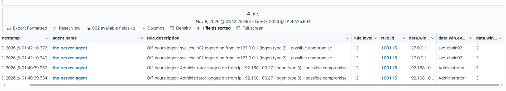
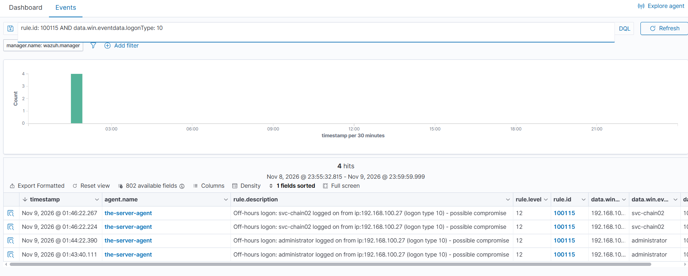
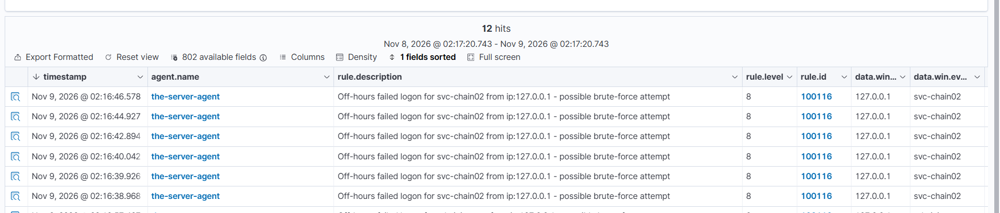
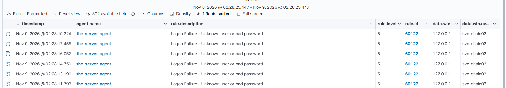

# Lab 05 — Off-Hours Logon Rules (100115 & 100116)

*Part of [03-Custom-Detection-Rules](../README.md). Tuning 4624 and 4625 by time: the same logon, at the wrong hour, is a different alert.*

---

> **Status: TESTED (Nov 9, 2026).** Both rules fired on generated events in the lab and the alerts were observed in Threat Hunting. The time-flip test and the lockout policy are recorded below. One open item remains: a type-10 firing under 100115 (see below).

## The problem

Lab 04 split the 4624 flood by **privilege** (100113 for the Administrator, 100114 for normal users). What it did not split by is **time**. A normal user logging on at noon is routine; the same user logging on at 3 AM is a possible compromise — and Lab 04's rules fire identically for both. The same gap exists for failed logons: rule 60122 fires at level 5 on every failure, including a daytime typo and a 3 AM brute-force attempt alike.

This lab adds the time dimension, reusing the off-hours pattern from rule 100109 (account created outside business hours, Lab 02). The window is the same in all three rules: `5 pm - 8 am` **UTC** (the manager's clock) — **10 PM – 1 PM PKT**.

## The design

Two rules, one for each direction of the logon:

| What happened | Rule | Level | Parent | Description |
|---|---|---|---|---|
| A human account logged on, off-hours | **100115** | 12 | none (independent) | Off-hours logon — possible compromise |
| A logon failed, off-hours | **100116** | 8 | **60122** (child) | Off-hours failed logon — possible brute-force attempt |

**100115** is independent: it fires *in addition* to 100113/100114. An off-hours Administrator logon generates both a 100113 alert (level 10, privilege) and a 100115 alert (level 12, timing). Two alerts, two angles. It carries the same seven human-only negates as 100114 (computer accounts `$`, SYSTEM, UMFD-, DWM `S-1-5-90-`, ANONYMOUS `S-1-5-7$`, LOCAL SERVICE `S-1-5-19$`, NETWORK SERVICE `S-1-5-20$`) — but **no `-500$` negate**, because it covers the Administrator too.

**100116** is a child of 60122 (`<if_sid>60122</if_sid>`) plus the time window. It inherits 60122's matching (any 4625) and adds only the time condition. When it fires, 60122 stays silent (shadowing); during on-hours it does not match, so 60122 fires again.

The full rule definitions live in [`local_rules-100115-100116.xml`](local_rules-100115-100116.xml) in this folder, with deep per-rule write-ups in [06-Custom-Detection-Rules-Reference](../../06-Custom-Detection-Rules-Reference/) ([100115](../../06-Custom-Detection-Rules-Reference/Rule-100115-Off-Hours-Logon.md), [100116](../../06-Custom-Detection-Rules-Reference/Rule-100116-Off-Hours-Failed-Logon.md)).

## The rules

Copy-paste ready — the same XML also lives in [`local_rules-100115-100116.xml`](local_rules-100115-100116.xml) in this folder. Append both rules inside the `<group>` of `local_rules.xml` on the manager.

```xml
<rule id="100115" level="12">
  <if_group>windows</if_group>
  <field name="win.system.eventID">^4624$</field>
  <field name="win.eventdata.logonType">^2$|^3$|^10$</field>
  <field name="win.eventdata.targetUserName" negate="yes">\$$</field>
  <field name="win.eventdata.targetUserName" negate="yes">^SYSTEM$</field>
  <field name="win.eventdata.targetUserName" negate="yes">^UMFD-</field>
  <field name="win.eventdata.targetUserSid" negate="yes">^S-1-5-90-</field>
  <field name="win.eventdata.targetUserSid" negate="yes">^S-1-5-7$</field>
  <field name="win.eventdata.targetUserSid" negate="yes">^S-1-5-19$</field>
  <field name="win.eventdata.targetUserSid" negate="yes">^S-1-5-20$</field>
  <time>5 pm - 8 am</time>
  <description>Off-hours logon: $(win.eventdata.targetUserName) logged on from ip:$(win.eventdata.ipAddress) (logon type $(win.eventdata.logonType)) - possible compromise</description>
  <mitre>
    <id>T1078</id>
  </mitre>
  <group>authentication_success,</group>
</rule>

<rule id="100116" level="8">
  <if_sid>60122</if_sid>
  <time>5 pm - 8 am</time>
  <description>Off-hours failed logon for $(win.eventdata.targetUserName) from ip:$(win.eventdata.ipAddress) - possible brute-force attempt</description>
  <mitre>
    <id>T1110</id>
  </mitre>
  <group>authentication_failed,</group>
</rule>
```

## Install

On the manager (Kali), from the folder holding your `local_rules.xml`:

```bash
docker cp local_rules.xml single-node-wazuh.manager-1:/var/ossec/etc/rules/local_rules.xml
docker exec single-node-wazuh.manager-1 chown wazuh:wazuh /var/ossec/etc/rules/local_rules.xml
docker exec single-node-wazuh.manager-1 /var/ossec/bin/wazuh-analysisd -t
docker exec single-node-wazuh.manager-1 /var/ossec/bin/wazuh-control restart
```

No `-it` — these are non-interactive commands. **Always `chown wazuh:wazuh` after `docker cp`** — `docker cp` leaves the file owned by uid 1000 and `wazuh-db` cannot read it (the Nov 8 outage: "Error reading XML file (line 0)" on a perfectly valid XML file). **Always run `wazuh-analysisd -t` before restarting** — it catches structural errors while the old rules are still running. **Edit single lines with `sed`, not `nano`** — a `nano` edit once deleted the `<group>` wrapper and broke the whole file. Always back the file up first (`cp local_rules.xml local_rules.xml.bak`).

Then confirm the rules loaded before testing: the config test must report no errors, and the proof is the test below, where the alerts either appear or they don't. Do not assert the rules loaded from the restart log alone.

## Test plan and evidence

Tested Nov 9, 2026. All times PKT unless noted.

### 100115 — off-hours successful logon

| # | Action | Expected alert | Result |
|---|---|---|---|
| 1 | RDP logon as `administrator` off-hours (01:40) | **100115 L12** | **Fired** — two hits at 01:40:39.957 and 01:40:39.734, description rendering correctly ("Off-hours logon: Administrator logged on from ip:192.168.100.27 (logon type 3) - possible compromise") |
| 2 | RDP logon as `administrator` off-hours, fresh session (type 10) | **100115 L12**, logon type 10 | **Fired** — administrator at 01:43:40.111 and 01:44:22.390, svc-chain02 at 01:46:22.224 and 01:46:22.267, all from 192.168.100.27 (L12, new description rendering). The 01:40 attempt was a session reconnection (type 3s only); fresh RDPs after it produced the type-10 rows. |



*The first 100115 firing (level 12) — Administrator type 3 from 192.168.100.27 at 01:40:39.957 and 01:40:39.734, svc-chain02 type 2 from 127.0.0.1 at 01:42:10.372 and 01:42:10.340. (The source screenshot crops the left edge of the timestamp column; the times are still readable.)*

---



*Query `rule.id: 100115 AND data.win.eventdata.logonType: 10` — four type-10 rows under 100115 (level 12): administrator at 01:43:40 and 01:44:22, svc-chain02 at 01:46:22, all from 192.168.100.27.*

---

**Noise note (honest):** the lab analyst works at night, so this rule fires on his own late-night logons. That is expected and correct — the rule detects off-hours logons, and the analyst triages them as known-good. If the noise becomes unmanageable, the tuning options are excluding the analyst's known IP or narrowing the time window — not deleting the rule.

### 100116 — off-hours failed logon

| # | Action | Expected alert | Result |
|---|---|---|---|
| 1 | Failed logons as `svc-chain02` off-hours (02:07–02:09) | **100116 L8** | **Fired** — multiple hits 02:07:37–02:09:49, from 192.168.100.27 |
| 2 | Failed logons as `administrator` off-hours (02:17–02:18, plus 01:43:30) | **100116 L8** | **Fired** — 02:17:53–02:18:05 and 01:43:30 |
| 3 | Check 60122 during the same window | 60122 silent (shadowed) | **Confirmed** — after 100116 loaded, `rule.id: 60122` showed just 4 old hits, latest 01:16:48 (before 100116 existed). All 02:07–02:18 attempts are under 100116. |



*Rule 100116 (level 8) firing on failed logons for svc-chain02, 02:16:38–02:16:46, from 127.0.0.1 — 12 hits in the window. (This image lives in the Event 4625 folder and is referenced from there; the file is stored once, in `05-Logon-and-Authentication-14-Events/Event-4625-logon-failure/images/`.)*

---

### The time-flip test (on-hours proof, Nov 9 02:28–02:31 PKT)

To prove the on-hours behaviour without waiting for 1 PM PKT, 100116's time window was temporarily flipped to `8 am - 5 pm` (UTC). After the restart, new failed logons fired **60122** (svc-chain02, 127.0.0.1, 02:28:11–02:31:09) and 100116 stopped firing for new attempts. **On-hours behaviour confirmed:** when 100116 does not match, the parent 60122 carries the detection.



*After 100116's window was flipped to `8 am - 5 pm`, new failed logons fired the built-in 60122 ("Logon Failure — Unknown user or bad password", level 5) instead — svc-chain02, 127.0.0.1, 02:28:11–02:28:19.*

---

**The flip was reverted** — the window was changed back to `5 pm - 8 am` with a global `sed` covering all three time rules (100109, 100115, 100116). The revert had a false step first: the flip command was re-run instead of the revert command, which flipped 100115's window instead of reverting 100116's; the global replace (`sed -i 's|8 am - 5 pm|5 pm - 8 am|g'`) fixed all three at once. **Open item: verify on the manager that all three time rules show `5 pm - 8 am`** — the revert was instructed but the final state was not confirmed in the session.

### The lockout policy (found during testing)

The testing itself tripped the domain lockout policy: both `Administrator` and `svc-chain02` locked out (rule **60115**, "User account locked out (multiple login errors)", level 9) at 02:10:55, 02:16:44, and 02:18:02.

`Get-ADDefaultDomainPasswordPolicy` on the DC:

| Setting | Value | Meaning |
|---|---|---|
| LockoutThreshold | **5** | 5 invalid logon attempts trigger a lockout |
| LockoutDuration | **00:30:00** | Locked for **30 minutes**, then auto-unlocks |
| LockoutObservationWindow | **00:30:00** | Failed-attempt counter resets after **30 minutes** |

That is why the Administrator account could log in again shortly after the lockout alert — the 30-minute duration had expired. No admin intervention is needed after 30 minutes; `Unlock-ADAccount -Identity <user>` unlocks immediately if you cannot wait. **Testing lesson:** five failed logons in 30 minutes locks the account you are testing with. Space the attempts out, use a dedicated test account, or be ready to unlock it.

## Lessons learned

### A failed RDP logon is always type 3, never type 10

A type 10 means an RDP **session was created**. When the password is wrong, authentication fails before any session exists — so Windows records the 4625 as a **network (type 3)** failure. Type 10 only exists when the logon **succeeds** and a session is established. Consequences: a failed RDP attempt will never appear under a type-10 filter (that is correct, not a gap); the `logoff` trick does not apply to failed logons (no session to clear). The reliable way to find failed RDP attempts is `rule.id: 100116` (off-hours) or `rule.id: 60122` (on-hours).

### A child rule suppresses its parent — and the parent is the fallback

100116 suppresses 60122 during off-hours, and 60122 fires again on-hours. That is the design working: the more specific rule carries the off-hours signal, the generic rule carries everything else. The same pattern holds for 100105/60141 and 100113/100114/60106. **Check what does *not* fire, not just what does** — a silent parent is the proof the child works.

### The time window is UTC, not local

All three off-hours rules use `5 pm - 8 am` against the manager's UTC clock — 10 PM – 1 PM PKT. An alert at 01:40 PKT is 20:40 UTC, inside the window. Always convert before concluding a time rule should or should not have fired.

### Logtest cannot prove Windows-rule shadowing here

The 4625 event from this testing (svc-chain02, 02:16:45, locked-out) was fed to `wazuh-logtest` twice (simplified JSON and full JSON with message). Both times Phase 2 decoded correctly (JSON decoder, all `win.*` fields), but Phase 3 fired **only generic rule 1002** (level 2) — the Windows rules 60122/100116 were never evaluated, because logtest uses the JSON decoder, not the Windows decoder. The live proof stands instead: the same event fired 100116 at 02:16 while 60122 stayed silent. The regression case is saved as `~/test-4625.json` on Kali.

## Threat Hunting in Wazuh

Paste into the search bar (Events tab) over the lab time window:

**100115 — off-hours logons:**
```
rule.id: 100115
```

**100116 — off-hours failed logons:**
```
rule.id: 100116
```

**60122 — all failed logons (built-in, on-hours):**
```
rule.id: 60122
```

**Lockouts:**
```
rule.id: 60115
```

## Open items

- **Type 10 under 100115 — CONFIRMED Nov 9 01:43–01:46.** Administrator at 01:43:40.111 and 01:44:22.390, svc-chain02 at 01:46:22.224 and 01:46:22.267, all from 192.168.100.27 (L12, new description rendering). The 01:40 attempt was a session reconnection (type 3s only); fresh RDPs after it produced the type-10 rows. Lab 05 is fully tested for both rules.
- **Revert verification (Kali-side).** Confirm all three time rules (100109, 100115, 100116) show `5 pm - 8 am` in the manager's `local_rules.xml`. The revert was instructed after the time-flip test but the final state was not confirmed in the session.
- **Sync to the durable pack.** These two rules are not yet in the repo's durable pack file (`custom-detection-rules/local_rules.xml`, rules 100100–100108). Sync them (and 100109/100110/100111–100114) into the pack as a separate job.
- **100100/100101 interaction.** The frequency rules 100100 and 100101 count 60122 hits. During off-hours, 100116 suppresses 60122, which may starve their counters at night. Verify in testing whether they still fire off-hours, or whether they need re-parenting.
