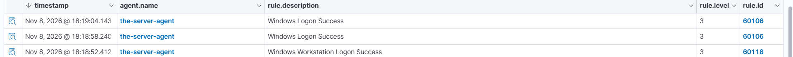
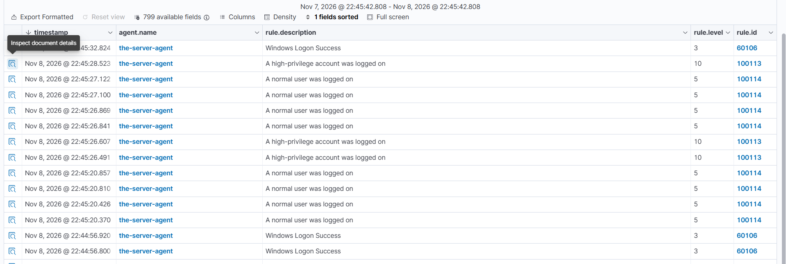
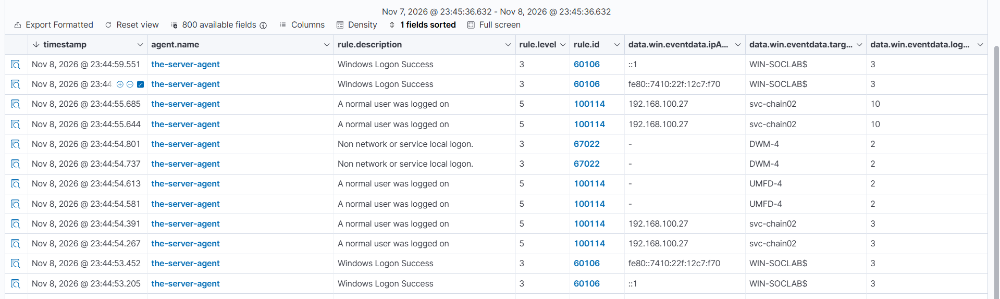
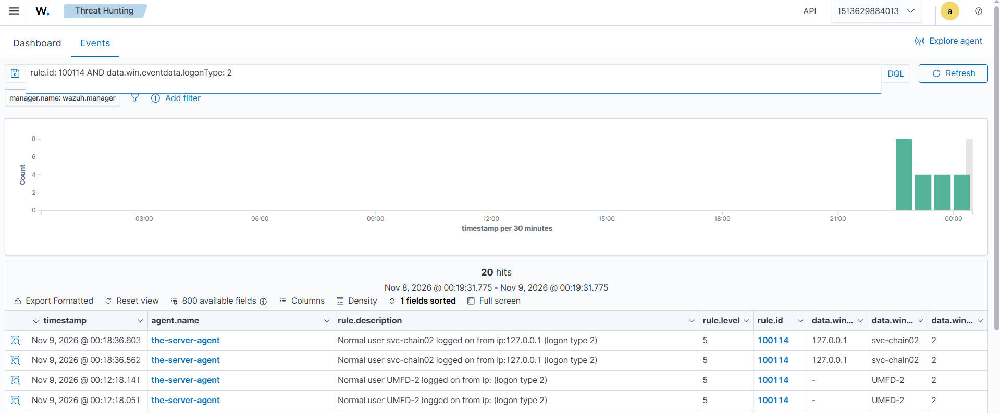
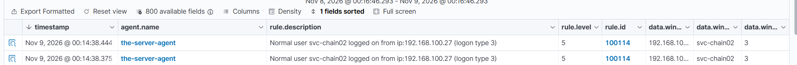
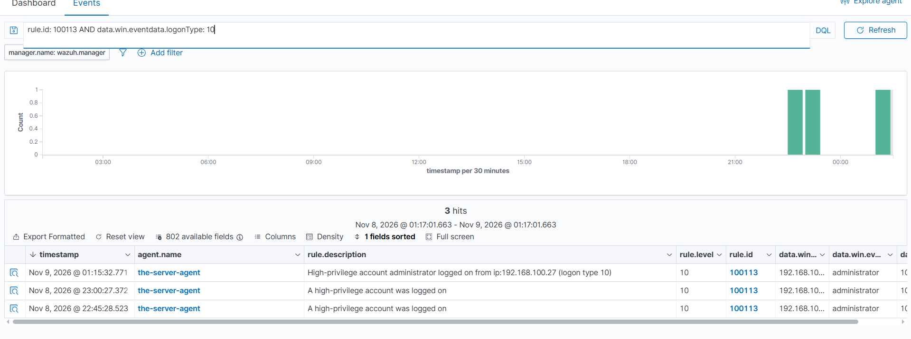
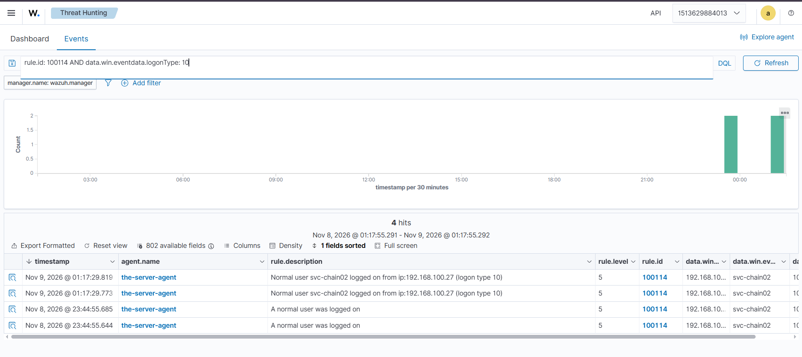
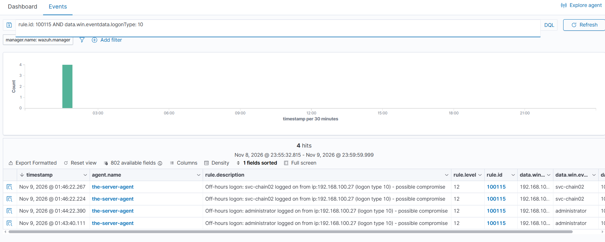

# Event 4624 — Successful Logon

*Part of the [Logon & Authentication lab](../README.md) — 14 Windows events mapped to Wazuh, interview-prep edition.*

---
**What it means:** An account successfully logged on to the domain controller. Every logon — console, network, or RDP — generates one 4624, with the account name, the logon type, the source IP, and the Logon ID that ties everything that account does in that session together.

**Why a SOC analyst cares:** *"4624 is where I start asking 'who logged on, from where, and what type?' On its own it's usually just a user starting work — but a privileged account logging on at 3 AM from an unknown IP, or a service account logging on interactively, is the first sign of a breach. The Logon ID is the thread: the same ID on a 4688 process creation proves that process belongs to that logon."*

**Wazuh:** built-in rule **60106** ("Windows Logon Success"), level **3** — verdict: **needs tuning**. It fires on every single 4624, so at any real scale this is a flood. Tuned with three custom rules: **100113** (level 10, Administrator), **100114** (level 5, normal human user), **100115** (level 12, off-hours logon). Verdict after tuning: **tuned — covered**.

---

## The problem: 60106 floods

Rule 60106 fires on **every** 4624. The alert list from Nov 8, 2026 was row after row of 60106, plus its child **60118** ("Windows Workstation Logon Success") on type 2 logons. Most of those rows are not people — they are Kerberos ticket logons, computer accounts (`WIN-SOCLAB$`), SYSTEM, and services. A real account logging on drowns in them.



*Rule 60106 ("Windows Logon Success", level 3) and its child 60118 ("Windows Workstation Logon Success") filling the alert list, Nov 8, 2026 — the flood before tuning.*

---

The 4624 that started the tuning (Nov 8, 2026, eventRecordID 1555053) shows the shape of the problem: logonType 2, `targetUserName: administrator`, `targetUserSid` ending `-500`, but `subjectUserName: WIN-SOCLAB$` and `ipAddress: 127.0.0.1`. One event, three stories at once — a person, a machine, and a local address. A rule that fires on all of them equally tells the analyst nothing.

The flood's source, once investigated: the 60106 rows carry IPs `::1` (IPv6 loopback) and `fe80::7410:22f:12c7:f70` (the DC's own link-local IPv6). **The 60106 flood is the DC logging on to itself locally, not outside attack.** That finding changed the triage: the flood is noise, and the tuning job is to separate the human logons from it.

## The tuning: split by privilege, then by time

Three custom rules, one split — by privilege, for the three human logon types (2 console, 3 network, 10 RDP), then by time:

| Who logs on | Rule | Level | Description |
|---|---|---|---|
| Administrator (SID `-500`) | **100113** | 10 | High-privilege account logged on, with username, IP, and logon type |
| Normal human user | **100114** | 5 | Normal user logged on, with username, IP, and logon type |
| Any human account, off-hours | **100115** | 12 | Off-hours logon — possible compromise |
| Computer account (`$`), SYSTEM, service | neither — 60106 still fires | 3 | Windows Logon Success (unchanged) |

100114 is human-only by exclusion: computer accounts end in `$`, SYSTEM is not a person, `UMFD-` accounts are font-driver virtual accounts, `S-1-5-90-` is the Desktop Window Manager, and `-500` belongs to 100113. Machine logons match none of the three custom rules, so 60106 still fires for them: coverage is preserved, the flood is split.



*The first test, Nov 8, 2026, 22:45 — 100113 (level 10, "A high-privilege account was logged on") and 100114 (level 5, "A normal user was logged on") firing with the original descriptions, 60106 rows alongside. This is the "before" shot for the description upgrade below.*

---

There is deliberately **no third generic rule** ("an account was logged on"). A rule matching every 4624 would either shadow the split rules or be shadowed by them — the two-tier split *is* the generic-plus-privileged design. 60106 already plays the generic role for the machine noise.

The full rule definitions live in [Lab 04](../../03-Custom-Detection-Rules/Lab-04-Logon-Tuning-100113-100114/) (100113, 100114) and [Lab 05](../../03-Custom-Detection-Rules/Lab-05-Off-Hours-Logon-Rules-100115-100116/) (100115), with deep per-rule write-ups in [06-Custom-Detection-Rules-Reference](../../06-Custom-Detection-Rules-Reference/).

## False positives found while testing

### DWM flood (Nov 8, 2026)

After the first test, 100114 fired on a flood of logons for accounts named `DWM-1`, `DWM-2`, `DWM-3` — the Desktop Window Manager. Every interactive or RDP logon spawns a DWM session, and each one generates its own 4624. The document detail proved it: account `DWM-3`, domain `Window Manager`, SID `S-1-5-90-0-3`, Virtual Account `Yes`, process `winlogon.exe`, logon type 2.

**Fix:** four SID negates added to 100114 — DWM prefix `^S-1-5-90-`, ANONYMOUS LOGON `^S-1-5-7$`, LOCAL SERVICE `^S-1-5-19$`, NETWORK SERVICE `^S-1-5-20$`. (DWM was proven by the document; the other three are standard non-human built-ins added preemptively.)



*Nov 8, 2026, 23:44 — the false positives in one list: DWM-4 firing 67022 and UMFD-4 firing 100114 ("A normal user was logged on", empty IP), next to real svc-chain02 logons (type 10 and type 3) and 60106 rows carrying `::1` and `fe80::7410:22f:12c7:f70` — the DC logging on to itself.*

---

### UMFD-2 (Nov 9, 2026)

A second false positive: **UMFD-2**, a Windows font-driver virtual account, fired 100114 as "Normal user UMFD-2 logged on from ip: (logon type 2)" — empty IP, because it never comes over the network. It passed the original negates (name doesn't end in `$`, isn't SYSTEM, SID isn't `-500`).

**Fix:** a `targetUserName` negate `^UMFD-` added to 100114. Confirmed working Nov 9 ~01:01 PKT — type 2 results after the fix show only real console logons.



*Query `rule.id: 100114 AND data.win.eventdata.logonType: 2` — UMFD-2 firing 100114 as "Normal user UMFD-2 logged on from ip: (logon type 2)" (00:12:18, empty IP) next to real svc-chain02 type-2 logons from 127.0.0.1 (00:18:36). The empty IP is the tell: it never comes over the network.*

---

### The description upgrade (Nov 8, 2026)

The original descriptions ("A high-privilege account was logged on" / "A normal user was logged on") said nothing about *who* or *from where*. The built-in RDP rule 92653 had a better message ("User: SOCLAB\svc-chain02 logged using Remote Desktop Connection (RDP) from ip:192.168.100.27"), so the custom descriptions were rebuilt the same way, using the same `$(win.eventdata.*)` field substitution:

- 100113: `High-privilege account $(win.eventdata.targetUserName) logged on from ip:$(win.eventdata.ipAddress) (logon type $(win.eventdata.logonType))`
- 100114: `Normal user $(win.eventdata.targetUserName) logged on from ip:$(win.eventdata.ipAddress) (logon type $(win.eventdata.logonType))`

Confirmed rendering correctly from Nov 9 00:14 onward (e.g. "Normal user svc-chain02 logged on from ip:192.168.100.27 (logon type 3)").



*The new descriptions rendering from Nov 9, 2026, 00:14:38 — "Normal user svc-chain02 logged on from ip:192.168.100.27 (logon type 3)" (rule 100114, level 5). Compare with the first-test shot above for the before/after.*

---

## Shadowing: what the custom rules suppress

On a human logon, 100113 or 100114 fires and **60106 stays silent** — the same shadowing behaviour Lab 01 proved for 100105/60141. Verified Nov 8 23:17 PKT: the query `rule.id: 60106 AND data.win.eventdata.ipAddress: 192.168.100.27` returned nothing.

The built-in RDP rule **92653** is also shadowed. Its last firing was Nov 8 18:08, before the custom rules were loaded (~22:16–22:40). After 100113/100114 loaded, every RDP logon fired the custom rules and 92653 went silent. That is the intended outcome — the custom rules carry the RDP detection now, with the privilege split 92653 never had — but it matters for Lab 03: rule 100112 chains on `<if_sid>92653</if_sid>`, and that parent no longer fires on type-10 logons. See the 100112 file in [06-Custom-Detection-Rules-Reference](../../06-Custom-Detection-Rules-Reference/Rule-100112-Full-Chain-RDP-Logon.md).

## Lessons from testing

### Reconnecting is not logging on (the type-10 mystery, Nov 9, 2026)

After 23:44 on Nov 8, repeated RDP attempts produced only type 3 alerts — no type 10 under any rule. The all-rules query `data.win.system.eventID: 4624 AND data.win.eventdata.logonType: 10` returned only 6 hits, the latest Nov 8 23:44: **Windows generated no new type 10 at all.** It was not a rule problem.

`query session` on the DC found the cause: the Administrator session was still `Active` and `svc-chain02` was `Disc` (disconnected but alive). Reconnecting to an existing session generates type 3 network authentication plus session-reconnect telemetry — it does **not** create a new type-10 4624.

**Fix:** `logoff` the session IDs, then open a fresh RDP window. Result: 100113 fired on Admin type 10 at **01:15:32.771** and 100114 fired on svc-chain02 type 10 at **01:17:29.819** on Nov 9.



*Query `rule.id: 100113 AND data.win.eventdata.logonType: 10` — the type-10 row at 01:15:32.771 with the new description ("High-privilege account administrator logged on from ip:192.168.100.27 (logon type 10)"), above the two old-description type-10 rows (23:00:27, 22:45:28).*

---



*Query `rule.id: 100114 AND data.win.eventdata.logonType: 10` — svc-chain02 type 10 at 01:17:29.819 and 01:17:29.773 with the new description, above the old-description rows (23:44:55).*

---

**The lesson:** when a type 10 is missing, check `query session` before blaming the rule. A missing type 10 usually means the session already exists.

### Type 3 alongside a type 10 is normal

An RDP logon generates **both** a type 10 (the RDP session) **and** type 3 network logons for the same user and IP — the type 3s are part of the same session. A type 3 on an RDP logon is normal Windows behaviour, not a mislabeled type 10 and not a rule mistake. The rule reports the logonType Windows recorded.

### A failed RDP logon is never type 10

A failed logon never creates a session, so Windows records the 4625 as a network (type 3) failure. Type 10 only exists when the logon **succeeds** and a session is established. See [Event 4625](../Event-4625-logon-failure/) — this is the rule that governs failed-logon triage, and it means a type-10 filter will never catch a failed RDP attempt.

## The known limit

100113 catches the **Administrator account** only. It does **not** catch a normal account that happens to be a member of a privileged group — `svc-chain02` is in `Domain-Admins-Custom`, but its own SID ends in `-1141`, so 100113 does not fire for it and 100114 does (calling it "normal"). That is wrong for the chain scenario, and the reason is structural: **group membership is not a field on the 4624 event**. The event knows who logged on, not what groups they belong to.

The proper fix is a correlation rule on **4672** (Special Privileges Assigned to New Logon): when a privileged-group member logs on, Windows fires 4672 with the same Logon ID. Chaining 4624 to a recent 4672 for the same Logon ID would catch every privileged logon, group membership included. That is the follow-up — it needs the 4672 rule ID verified first (Phase 2 sheet, still "verify in lab").

## Test evidence

Tested Nov 8–9, 2026. All three logon types verified for both tiers:

- **Admin (100113):** type 10 at 01:15:32 (fresh RDP after logoff); type 3s at 01:15:31, 01:13:10, 01:04:44, 00:21:18; type 2 console from 127.0.0.1 at 01:19:12, 01:10:51.
- **svc-chain02 (100114):** type 10 at 01:17:29 (fresh RDP after logoff); type 3s at 01:17:28, 00:55:11, 00:28:39, 00:14:38; type 2 console from 127.0.0.1 at 01:21:19, 01:00:00.
- **Off-hours (100115):** Admin type 3 at 01:40:39 (L12, new description rendering). Type 10 confirmed: administrator at 01:43:40 and 01:44:22, svc-chain02 at 01:46:22 (L12, new description rendering) — the 01:40 attempt was a session reconnection (type 3s only), and fresh RDPs after it produced the type-10 rows.



*Query `rule.id: 100115 AND data.win.eventdata.logonType: 10` — four type-10 rows under 100115 (level 12): administrator at 01:43:40 and 01:44:22, svc-chain02 at 01:46:22, all from 192.168.100.27. Type 10 under 100115 is confirmed.*

---
- **Shadowing:** 60106 silent on human logons (verified by IP query); 92653 last fired Nov 8 18:08, silent after the custom rules loaded.
- **Descriptions:** new 92653-style descriptions confirmed rendering from Nov 9 00:14 onward.
- **False positives fixed:** DWM flood (four SID negates), UMFD-2 (`^UMFD-` negate) — both confirmed gone after the fix.

**Generate (RDP, type 10):** open a fresh `mstsc` window from your own PC as the test user — a user-switch inside an admin session gives type 2, not type 10. If the session already exists, `logoff` it first (`query session` on the DC, then `logoff <id>`).

**Generate (console, type 2):** log on at the DC console.

**Generate (network, type 3):** `net use \\192.168.100.146\C$ /user:SOCLAB\svc-chain02` from your PC.

---

## Threat Hunting in Wazuh

Threat Hunting uses DQL. Paste these into the search bar (Events tab) over the lab time window. Threat Hunting shows the **alerts** index only — if an event fired no rule, it is invisible here; check the archives index or `Get-WinEvent` on the DC instead.

**100113 — high-privilege logons:**
```
rule.id: 100113
```

**100114 — normal user logons:**
```
rule.id: 100114
```

**100115 — off-hours logons:**
```
rule.id: 100115
```

**100115, type 10 only:**
```
rule.id: 100115 AND data.win.eventdata.logonType: 10
```

**All 4624s for one account:**
```
data.win.system.eventID: 4624 AND data.win.eventdata.targetUserName: svc-chain02
```

**Human logons only** (drops computer accounts ending in `$` and SYSTEM noise):
```
data.win.system.eventID: 4624 AND NOT data.win.eventdata.targetUserName: *$ AND NOT data.win.eventdata.targetUserName: SYSTEM
```

**Human logons from my PC** (the shadowing check — 60106 must stay silent here):
```
rule.id: 60106 AND data.win.eventdata.ipAddress: 192.168.100.27
```

**One account, one logon, the full chain** (the Logon ID ties the logon to everything the session did — the same ID on a 4688 proves that process belongs to this logon):
```
data.win.system.eventID: 4624 AND data.win.eventdata.targetUserName: svc-chain02 AND data.win.eventdata.logonType: 10
```

Add `targetUserName`, `logonType`, and `ipAddress` as Discover columns (via the Columns panel) to see names per row — typing field names in the search bar does not create a column. Full dashboard tips live in [Detection-Commands.md](../Detection-Commands.md).
