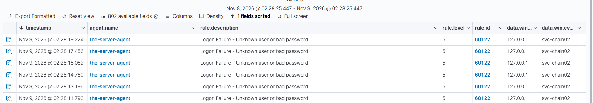
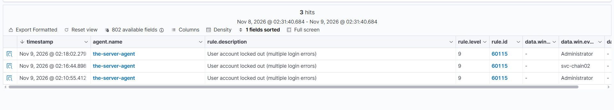
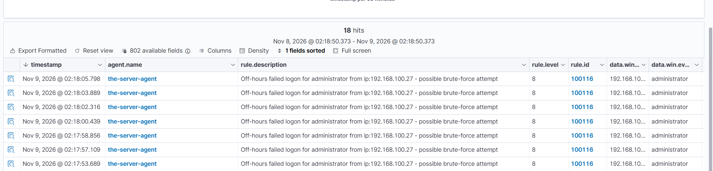
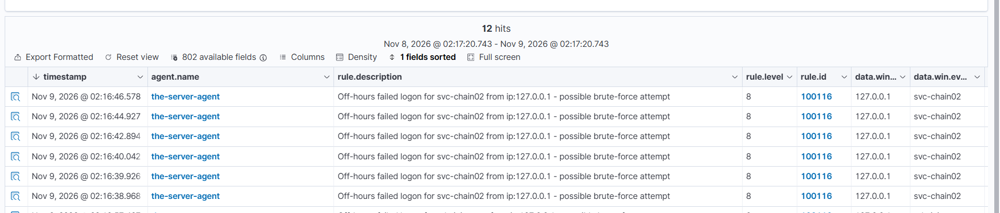

# Event 4625 — Failed Logon

*Part of the [Logon & Authentication lab](../README.md) — 14 Windows events mapped to Wazuh, interview-prep edition.*

---
**What it means:** An account failed to log on. The request reached the domain controller and was rejected — wrong password, unknown account, or (in this lab's testing) an account locked out after too many failures. The event carries the target account, the logon type, the source IP, and the failure status code (e.g. `0xC0000234` = account locked out, `0xC000006D` = bad password).

**Why a SOC analyst cares:** *"4625 is where I start asking 'who is guessing passwords, and against which account?' One failure is a typo — anyone can mistype once. A burst of failures against one account is a brute-force attack in progress, and a burst outside business hours is an attacker working while nobody is watching. The status code tells me which: bad password means guessing, account-locked-out means the guessing already worked well enough to trip the lockout."*

**Wazuh:** built-in rule **60122** ("Logon Failure — Unknown user or bad password"), level **5** — verdict: **needs tuning**. It fires on every single failed logon, including daytime typos. Tuned with one custom rule: **100116** (level 8, off-hours failed logon, child of 60122). Verdict after tuning: **tuned — covered**.

---

## The problem: 60122 fires on everything

Rule 60122 fires on every failed logon at level 5 — a mistyped password at noon and a brute-force attempt at 3 AM get the same alert. The dangerous subset is the **off-hours** failure: an attacker guessing passwords while the target is asleep is the pattern that matters, and level 5 does not express it.

## The tuning: one child rule for off-hours

| When it fails | Rule | Level | Description |
|---|---|---|---|
| Off-hours (5 pm – 8 am UTC) | **100116** | 8 | Off-hours failed logon — possible brute-force attempt |
| On-hours (8 am – 5 pm UTC) | **60122** (built-in) | 5 | Logon Failure — Unknown user or bad password |

100116 is a **child of 60122** (`<if_sid>60122</if_sid>`) plus the off-hours time window. It inherits 60122's matching (any 4625) and adds only the time condition. The full rule definition lives in [Lab 05](../../03-Custom-Detection-Rules/Lab-05-Off-Hours-Logon-Rules-100115-100116/), with a deep write-up in [06-Custom-Detection-Rules-Reference](../../06-Custom-Detection-Rules-Reference/Rule-100116-Off-Hours-Failed-Logon.md).

The time window is `5 pm - 8 am` **UTC** (the manager's clock), the same window as 100109 and 100115 — **10 PM – 1 PM PKT**.

## Shadowing: what the child suppresses

When 100116 fires, **60122 stays silent** — the child suppresses its parent on match, the same shadowing behaviour Lab 01 proved for 100105/60141. Verified Nov 9 02:23 PKT: after 100116 loaded (~01:40), every failed logon fired 100116 only. The `rule.id: 60122` query showed just 4 old hits, the latest 01:16:48 — before 100116 existed. The recent failed attempts (02:07–02:18) were all under 100116.

During **on-hours**, 100116 does not match (wrong time window), so 60122 fires again for failed logons. Confirmed by the time-flip test below.

## Lessons from testing

### A failed RDP logon is always type 3, never type 10

This was the most confusing finding of the night, and it is Windows behaviour, not a rule problem.

A **type 10** (RemoteInteractive) logon means an RDP **session was created**. When the password is wrong, authentication fails before any session exists — so Windows records the 4625 as a **network (type 3)** failure. Type 10 only exists when the logon **succeeds** and a session is established.

Consequences for triage:
- A failed RDP attempt will **never** appear under a type-10 filter. Filtering 4625s by `logonType: 10` returns nothing — that is correct, not a gap.
- The `logoff` trick does not apply to failed logons. There is no session to clear, because no session was ever created. Logging off existing sessions changes nothing about how a *failed* attempt is recorded.
- The reliable way to find failed RDP attempts is `rule.id: 100116` (off-hours) or `rule.id: 60122` (on-hours), not a logon-type filter.

### The time-flip test (Nov 9, 02:28–02:31 PKT)

To prove the on-hours behaviour without waiting for 1 PM PKT, 100116's time window was temporarily flipped to `8 am - 5 pm` (UTC). After the restart, new failed logons fired **60122** (svc-chain02, 127.0.0.1, 02:28:11–02:31:09) and 100116 stopped firing for new attempts. On-hours behaviour confirmed: when 100116 does not match, the parent 60122 carries the detection.



*After 100116's window was flipped to `8 am - 5 pm`, new failed logons fired the built-in 60122 ("Logon Failure — Unknown user or bad password", level 5) instead — svc-chain02, 127.0.0.1, 02:28:11–02:28:19. The parent carries the detection when the child does not match.*

---

**The flip was reverted** — the window was changed back to `5 pm - 8 am` with a global `sed` (all three time rules: 100109, 100115, 100116) and the manager restarted. The revert had a false step first (the flip command was re-run instead of the revert command, which flipped 100115 instead of reverting 100116) — the global replace fixed all three at once. **Open item:** verify on the manager that all three time rules show `5 pm - 8 am` — the revert was instructed but the final state was not confirmed in the session.

### The lockout policy (Nov 9, 02:36 PKT)

The testing itself tripped the domain lockout policy: both `Administrator` and `svc-chain02` locked out (rule **60115**, "User account locked out (multiple login errors)", level 9) at 02:10, 02:16, and 02:18.

`Get-ADDefaultDomainPasswordPolicy` on the DC:

| Setting | Value | Meaning |
|---|---|---|
| LockoutThreshold | **5** | 5 invalid logon attempts trigger a lockout |
| LockoutDuration | **00:30:00** | The account stays locked for **30 minutes**, then auto-unlocks |
| LockoutObservationWindow | **00:30:00** | The failed-attempt counter resets after **30 minutes** |

That is why the Administrator account could log in again shortly after the lockout alert — the 30-minute duration had expired and the account auto-unlocked. No admin intervention is needed after 30 minutes; `Unlock-ADAccount -Identity <user>` unlocks immediately if you cannot wait.



*Rule 60115 ("User account locked out (multiple login errors)", level 9) — Administrator locked out at 02:10:55 and 02:18:02, svc-chain02 at 02:16:44, all during the failed-logon testing.*

---

**The testing lesson:** five failed logons in 30 minutes locks the account you are testing with. Space the attempts out, use a dedicated test account, or be ready to unlock it.

## Test evidence

Tested Nov 9, 2026:

- **100116 (off-hours):** fired on failed logons for `svc-chain02` (multiple attempts 02:07:37–02:09:49, from 192.168.100.27) and `administrator` (02:17:53–02:18:05, from 192.168.100.27; plus 01:43:30). Level 8, description rendering correctly: "Off-hours failed logon for svc-chain-02 from ip:192.168.100.27 - possible brute-force attempt".



*Rule 100116 (level 8) firing on failed logons for administrator, 02:17:53–02:18:05, from 192.168.100.27 — 18 hits in the window.*

---



*Rule 100116 (level 8) firing on failed logons for svc-chain02, 02:16:38–02:16:46, from 127.0.0.1 — 12 hits in the window. Same rule, same night, different account and source.*

---
- **60122 suppressed (off-hours):** after 100116 loaded, no new 60122 hits — latest 60122 was 01:16:48, before 100116 existed.
- **60122 (on-hours, time-flip test):** fired on new failed logons 02:28:11–02:31:09 (svc-chain02, 127.0.0.1) after 100116's window was flipped to `8 am - 5 pm`. 100116 stopped firing for new attempts in the same window.
- **Lockouts:** 60115 L9 fired for both accounts (02:10:55 Administrator, 02:16:44 svc-chain02, 02:18:02 Administrator).
- **Failed RDP = type 3:** every failed RDP attempt in this testing recorded logonType 3, never 10 — confirmed across both accounts and both IPs (192.168.100.27 and 127.0.0.1).

**Generate (failed logon):** attempt an RDP logon with a wrong password (`mstsc` to 192.168.100.146 as `SOCLAB\svc-chain02`, wrong password), or a console logon with a wrong password on the DC. **Warning:** five failures within 30 minutes locks the account — use a test account, and unlock it with `Unlock-ADAccount -Identity svc-chain02` when you are done.

---

## Threat Hunting in Wazuh

Threat Hunting uses DQL. Paste these into the search bar (Events tab) over the lab time window. Threat Hunting shows the **alerts** index only — if an event fired no rule, it is invisible here; check the archives index or `Get-WinEvent` on the DC instead.

**100116 — off-hours failed logons:**
```
rule.id: 100116
```

**60122 — all failed logons (built-in, on-hours):**
```
rule.id: 60122
```

**All 4625s for one account:**
```
data.win.system.eventID: 4625 AND data.win.eventdata.targetUserName: svc-chain02
```

**Failed logons by status** (locked out vs bad password — the status code is the story):
```
data.win.system.eventID: 4625 AND data.win.eventdata.status: 0xC0000234
```

**Lockouts:**
```
rule.id: 60115
```

Add `targetUserName`, `logonType`, and `ipAddress` as Discover columns (via the Columns panel) to see names per row — typing field names in the search bar does not create a column. Full dashboard tips live in [Detection-Commands.md](../Detection-Commands.md).
