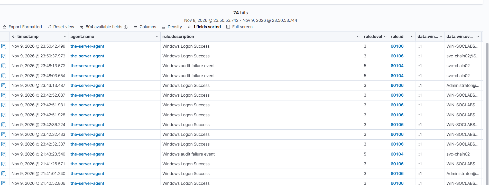
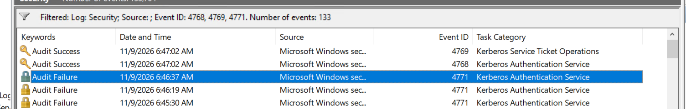
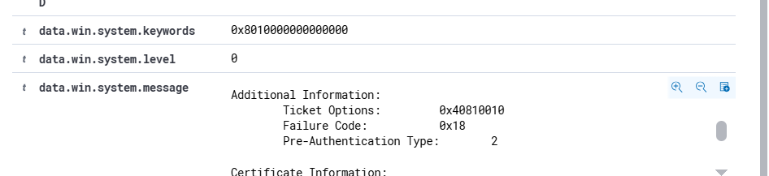

# Event 4768 — Kerberos TGT Requested

*Part of the [Logon & Authentication lab](../README.md) — 14 Windows events mapped to Wazuh, interview-prep edition.*

---
**What it means:** A domain user requested an initial **Ticket Granting Ticket (TGT)** from the Active Directory Key Distribution Center (KDC / Domain Controller). This is Step 1 of the Kerberos authentication dance (AS-REQ / AS-REP). Every initial domain authentication begins with a 4768 request against the `krbtgt` service.

**Why a SOC analyst cares:** *"4768 is where I catch AS-REP Roasting and anomalous domain authentication requests. If an account has 'Do not require Kerberos preauthentication' enabled (DONT_REQ_PREAUTH), an attacker can request a TGT without knowing the password, receive an encrypted AS-REP response (`PreAuthType = 0`), and crack the account's password offline. A sudden burst of 4768s with PreAuthType 0, or requests for sensitive admin accounts from non-domain or unusual IPs, is a critical early indicator of credential harvesting."*

**Wazuh:** Built-in rule **60104** only inspects failed authentication; default Wazuh rulesets suppress successful 4768s at level 0 to avoid noise. Covered with custom rule **100117** (level **3**, "Kerberos: TGT ticket requested by $(win.eventdata.targetUserName)"). Status: **TESTED — covered**.

---

## The problem: Default SIEM suppression of TGTs

Routine Windows domain traffic generates hundreds of routine TGT requests as users log on and renew tickets. Built-in Wazuh rule `60106` handles successful logons (4624), but default rules ignore successful 4768 events at `level 0` to prevent SIEM storage exhaustion.

However, completely blinding the SOC to Event 4768 leaves a major gap: **AS-REP Roasting (MITRE ATT&CK T1558.004)** occurs entirely during the TGT exchange. Without logging 4768, an attacker extracting Kerberos hashes for offline cracking generates zero telemetry.

## The solution: Custom Rule 100117

Rule **100117** captures TGT issuance and extracts the target account, client IP, ticket options, and encryption type:

```xml
<group name="windows,security,">
  <rule id="100117" level="3">
    <if_sid>60103</if_sid>
    <field name="win.system.eventID">^4768$</field>
    <description>Kerberos: TGT ticket requested by $(win.eventdata.targetUserName) from $(win.eventdata.ipAddress)</description>
    <mitre>
      <id>T1558.004</id>
    </mitre>
  </rule>
</group>
```



*Wazuh Threat Hunting alert list showing 13 hits for custom Rule 100117 (level 3) firing on TGT requests for `victim-asrep` on `WIN-SOCLAB`.*

---

## Key Fields for SOC Investigation

| Field | Description | Normal Value | Malicious / Suspicious Tell |
|---|---|---|---|
| `TargetUserName` | Account requesting the TGT | Standard user | `krbtgt`, sensitive DA accounts, or accounts with pre-auth disabled |
| `ServiceName` | Ticket target service | `krbtgt` | Anything other than `krbtgt` indicates an anomaly |
| `PreAuthType` | Pre-authentication mechanism | `2` (PA-ENC-TIMESTAMP) or `15` | `0` (Pre-authentication not required — **AS-REP Roasting vector**) |
| `TicketEncryptionType` | Cipher suite used | `0x12` (AES-256) | `0x17` (RC4-HMAC — weak legacy cipher) |
| `IpAddress` | Requesting workstation IP | Internal subnet | Attacker IP (e.g. Kali Linux `192.168.100.50`) or loopback |
| `Status` | Result code | `0x0` (Success) | `0x18` (Pre-auth failed / bad password — see Event 4771) |



*Windows Event Viewer Event 4768 — TGT requested for `Administrator` with Service Name `krbtgt` and `Status: 0x0`.*

---

## Lab Generation & Verification

### Method 1 — PowerShell Ticket Purge and Renewal
```powershell
# Purge cached Kerberos tickets and inspect active session
klist purge
klist
```



*Cached Kerberos tickets flushed and verified via `klist` on `WIN-SOCLAB`.*

### Method 2 — Query Event 4768 via PowerShell
```powershell
Get-WinEvent -FilterHashtable @{LogName='Security'; Id=4768} -MaxEvents 5 | ForEach-Object {
    $xml = [xml]$_.ToXml()
    [PSCustomObject]@{
        TimeCreated = $_.TimeCreated
        TargetUser  = ($xml.Event.EventData.Data | Where-Object {$_.Name -eq 'TargetUserName'}).'#text'
        ServiceName = ($xml.Event.EventData.Data | Where-Object {$_.Name -eq 'ServiceName'}).'#text'
        PreAuthType = ($xml.Event.EventData.Data | Where-Object {$_.Name -eq 'PreAuthType'}).'#text'
        TicketEnc   = ($xml.Event.EventData.Data | Where-Object {$_.Name -eq 'TicketEncryptionType'}).'#text'
        ClientIP    = ($xml.Event.EventData.Data | Where-Object {$_.Name -eq 'IpAddress'}).'#text'
    }
} | Format-Table -AutoSize
```

---

## SOC Analyst Takeaways

1. **PreAuthType 0 is the Golden Metric:** Normal Windows clients always submit a timestamp encrypted with the user's password hash (`PreAuthType = 2`). If `PreAuthType = 0` appears, that account is vulnerable to offline password cracking.
2. **Audit Subcategory Required:** TGT issuance requires the **Audit Kerberos Authentication Service** subcategory to be set to `Success and Failure`. If disabled, 4768 will not be written to the Security log.
3. **Correlate with 4769:** A legitimate user requests a TGT (4768) and then immediately requests service tickets (4769). An attacker conducting AS-REP Roasting requests a TGT with PreAuthType 0 and never requests a 4769 service ticket.
