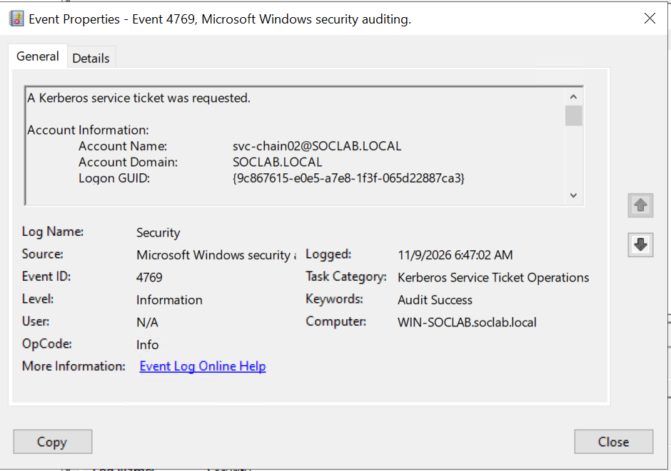
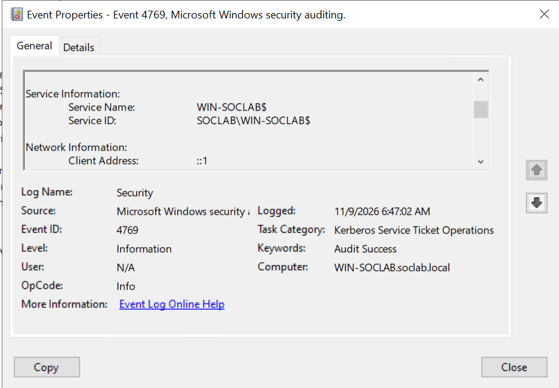
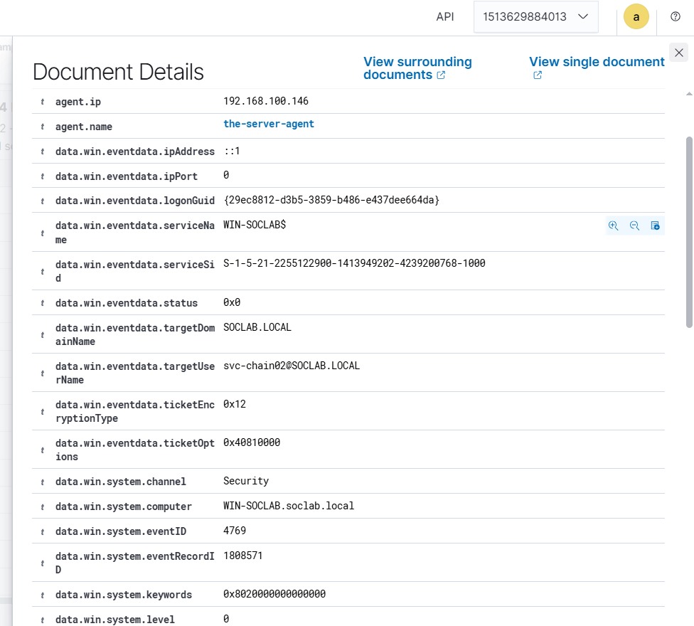

# Event 4769 — Kerberos Service Ticket Requested

*Part of the [Logon & Authentication lab](../README.md) — 14 Windows events mapped to Wazuh, interview-prep edition.*

---
**What it means:** A domain user presented their TGT to the Key Distribution Center (KDC) to request a **Service Ticket (TGS)** to access a specific network service (e.g., file share, database, RDP, or web service). This is Step 2 of the Kerberos exchange (TGS-REQ / TGS-REP).

**Why a SOC analyst cares:** *"4769 is the single most important event for detecting Kerberoasting (MITRE ATT&CK T1558.003) and internal lateral movement. In Active Directory, any authenticated user can request a service ticket for any account with a registered Service Principal Name (SPN). Because the service ticket is encrypted with the service account's NTLM password hash, an attacker requests service tickets in bulk, extracts the encrypted blobs, and cracks the passwords offline. If I see a burst of 4769s requesting weak RC4-HMAC encryption (`0x17`) instead of AES-256 (`0x12`), that is a Kerberoasting attack in progress."*

**Wazuh:** Built-in rule **60106** / **60104** captures Windows authentication events. Mapped to custom rule **100102** ("Kerberoasting attempt — Service ticket requested with weak RC4 encryption", level **10**). Status: **COVERED**.

---

## The Threat: Kerberoasting Mechanics

Unlike AS-REP Roasting (which targets accounts without pre-authentication), Kerberoasting targets **service accounts with registered SPNs**. 

1. **Adversary Emulation:** The attacker uses tools like Impacket's `GetUserSPNs.py` or `Rubeus kerberoast`.
2. **Cipher Downgrade:** The attacker deliberately requests ticket encryption type `0x17` (RC4-HMAC) because RC4 hashes crack orders of magnitude faster in `hashcat` and `john` than AES-256 (`0x12`).
3. **Telemetry Signature:** An Event 4769 is logged on the Domain Controller with:
   - `ServiceName` = Name of the targeted service account.
   - `TicketEncryptionType` = `0x17` (RC4).
   - `TicketOptions` = `0x40810000` (Forwardable, Renewable).




---


---


---


---


---

*Windows Event Viewer Event 4769 — Kerberos Service Ticket requested for file share access on `WIN-SOCLAB`.*

---

## Key Fields for SOC Investigation

| Field | Description | Normal Value | Malicious Indicator |
|---|---|---|---|
| `TargetUserName` | User requesting the service ticket | Expected domain user | Low-privileged user requesting tickets for high-value services |
| `ServiceName` | Target Service Account / SPN | Host or computer account (`$` ending) | User service accounts (`svc-sql`, `svc-backup`) |
| `TicketEncryptionType` | Encryption algorithm used | `0x12` (AES-256) | `0x17` (RC4-HMAC downgrade) |
| `TicketOptions` | Kerberos request flags | Standard flags (`0x40810000`) | Abnormal options flags |
| `IpAddress` | Workstation IP of requestor | Corporate IP subnet | Non-standard workstation, VPN endpoint, or attacker machine |
| `Status` | Result code | `0x0` (Success) | `0x20` (Ticket expired), `0x1B` (Server principal unknown) |



*Event 4769 Service Information showing targeted Service Name and SID on `soclab.local`.*

---

## Lab Generation & Detection

### Generating Event 4769 via File Share Access
```powershell
# Access an administrative SMB share as a domain user to trigger a TGS request
Get-ChildItem -Path "\\WIN-SOCLAB\C$" -ErrorAction SilentlyContinue
```

### Detection Command via PowerShell
```powershell
Get-WinEvent -FilterHashtable @{LogName='Security'; Id=4769} -MaxEvents 5 | ForEach-Object {
    $xml = [xml]$_.ToXml()
    [PSCustomObject]@{
        TimeCreated = $_.TimeCreated
        TargetUser  = ($xml.Event.EventData.Data | Where-Object {$_.Name -eq 'TargetUserName'}).'#text'
        ServiceName = ($xml.Event.EventData.Data | Where-Object {$_.Name -eq 'ServiceName'}).'#text'
        TicketEnc   = ($xml.Event.EventData.Data | Where-Object {$_.Name -eq 'TicketEncryptionType'}).'#text'
        ClientIP    = ($xml.Event.EventData.Data | Where-Object {$_.Name -eq 'IpAddress'}).'#text'
    }
} | Format-Table -AutoSize
```



*Wazuh Threat Hunting document detail displaying Event 4769 fields parsed into Elasticsearch JSON.*

---

## SOC Analyst Takeaways

1. **Machine Accounts vs User Accounts:** Machine account SPNs (e.g. `HOST/computer$`) have 128-character random passwords that rotate every 30 days and cannot be cracked. Kerberoasting attacks specifically filter for **user-account SPNs**.
2. **RC4 vs AES:** Modern Active Directory environments should disable RC4 domain-wide. Any 4769 with `TicketEncryptionType: 0x17` in an environment running Windows Server 2016+ warrants an immediate SOC investigation.
3. **Threshold Alerting:** Legitimate applications request service tickets intermittently. Attackers enumerate all SPNs and request tickets in a tight time window (e.g., >10 service tickets within 60 seconds).
