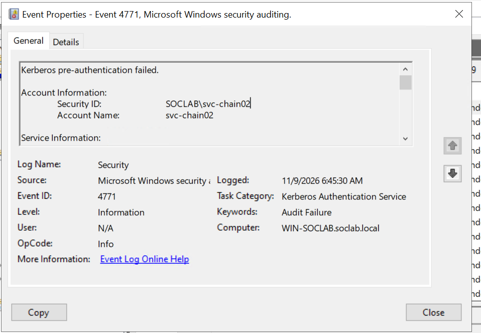
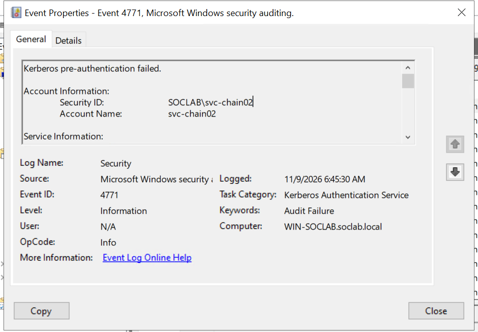
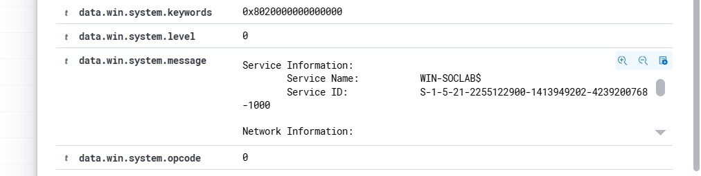
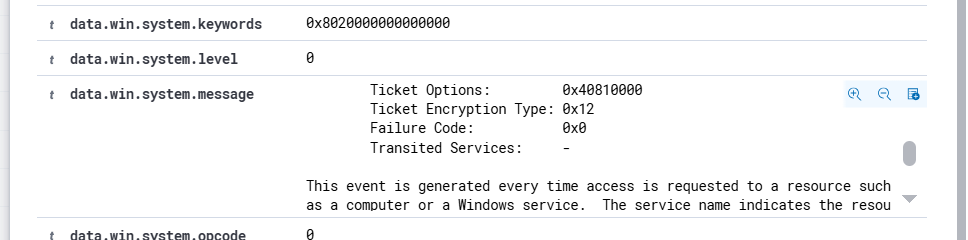

# Event 4771 — Kerberos Pre-Authentication Failed

*Part of the [Logon & Authentication lab](../README.md) — 14 Windows events mapped to Wazuh, interview-prep edition.*

---
**What it means:** An attempt to obtain a Kerberos TGT failed because the client could not validate knowledge of the account password during the pre-authentication phase. In modern Active Directory, clients encrypt a current timestamp (`PA-ENC-TIMESTAMP`) using a key derived from the user's password; if the KDC cannot decrypt it or the password is wrong, pre-authentication fails and Event 4771 is logged.

**Why a SOC analyst cares:** *"4771 is the pure Kerberos equivalent of 4625. While 4625 tracks workstation and network logon rejections across multiple protocols, 4771 is generated directly on the Domain Controller when an authentication attempt fails against the KDC. A sudden spike in 4771 events with failure code `0x18` (bad password) against multiple accounts from a single IP indicates a Kerberos password-spraying attack. If it occurs against a single privileged account, it is a brute-force or credential-stuffing attempt."*

**Wazuh:** Built-in rule **60104** ("Logon Failure - Kerberos pre-authentication failed", level **5**). Status: **COVERED**.

---

## Failure Code Reference (RFC 4120)

Event 4771 provides hexadecimal failure codes in the `FailureCode` or `Status` field that pinpoint the root cause:

| Failure Code | Meaning | SOC Interpretation |
|---|---|---|
| `0x18` | `KDC_ERR_PREAUTH_FAILED` | Bad password. The client attempted to authenticate with an invalid password. |
| `0x12` | `KDC_ERR_CLIENT_REVOKED` | Client account is locked out, disabled, or expired. |
| `0x17` | `KDC_ERR_KEY_EXPIRED` | User's password has expired. |
| `0x25` | `KDC_ERR_PREAUTH_EXPIRED` | Time difference (clock skew) between DC and client exceeds 5 minutes. |
| `0x6` | `KDC_ERR_C_PRINCIPAL_UNKNOWN` | Username does not exist in Active Directory. |



*Windows Event Viewer Event 4771 — Pre-authentication failed with Result Code `0x18` (Bad Password) for `Administrator`.*

---

## Key Fields for SOC Investigation

| Field | Description | Normal Value | Malicious Indicator |
|---|---|---|---|
| `TargetUserName` | Account being authenticated | Standard domain user | High-privilege accounts (`Administrator`, `krbtgt`, domain admins) |
| `FailureCode` | Hexadecimal Kerberos error | `0x18` (occasional typo) | Burst of `0x18` across multiple accounts or single account |
| `IpAddress` | Originating IP address | Internal workstation subnet | External IP, unknown subnet, or loopback proxy |
| `PreAuthType` | Pre-authentication mechanism | `2` (Encrypted Timestamp) | Missing or non-standard pre-auth type |



*Event 4771 XML EventData showing `FailureCode: 0x18` and Client `IpAddress: ::1`.*

---

## Lab Generation & Detection

### Generating Event 4771 via PowerShell
```powershell
# Attempt an explicit logon using an incorrect password to trigger Kerberos pre-auth failure
$secPass = ConvertTo-SecureString "IntentionalWrongPass999!" -AsPlainText -Force
$cred = New-Object System.Management.Automation.PSCredential("soclab\Administrator", $secPass)
Start-Process powershell.exe -Credential $cred -NoNewWindow -ErrorAction SilentlyContinue
```



---


---


---


---

*Intentional wrong password entered via command line generating Kerberos error 1326 / 4771.*

### Detection Command via PowerShell
```powershell
Get-WinEvent -FilterHashtable @{LogName='Security'; Id=4771} -MaxEvents 5 | ForEach-Object {
    $xml = [xml]$_.ToXml()
    [PSCustomObject]@{
        TimeCreated = $_.TimeCreated
        TargetUser  = ($xml.Event.EventData.Data | Where-Object {$_.Name -eq 'TargetUserName'}).'#text'
        FailureCode = ($xml.Event.EventData.Data | Where-Object {$_.Name -eq 'Status'}).'#text'
        ClientIP    = ($xml.Event.EventData.Data | Where-Object {$_.Name -eq 'IpAddress'}).'#text'
    }
} | Format-Table -AutoSize
```
---


---




*Wazuh Threat Hunting alert detail confirming Rule 60104 firing on Kerberos pre-authentication failure.*

---

## SOC Analyst Takeaways

1. **Subcategory Dependency:** Event 4771 will **not** appear unless the **Audit Kerberos Authentication Service** subcategory is configured for `Failure`. Without this setting, attackers can spray Kerberos passwords without leaving a single 4771 entry on the DC.
2. **Account Lockout Correlation:** When an attacker triggers multiple consecutive 4771s with `FailureCode: 0x18`, Active Directory threshold policies will trigger Event **4740** (Account Locked Out). Always correlate 4771 spikes with 4740 events.
3. **4771 vs 4625:** 4771 is generated exclusively on Domain Controllers where the KDC resides. A 4625 failure can be logged on member servers, endpoints, and DCs depending on whether NTLM, RDP, or local authentication was attempted.
