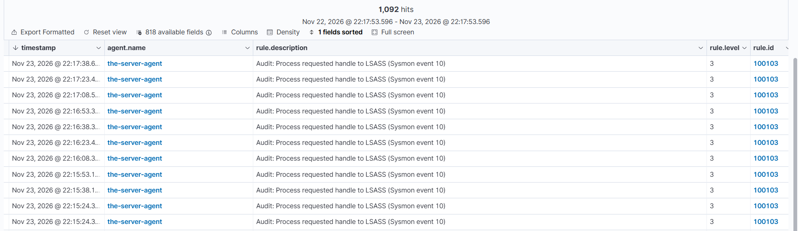

# Rule 100103 — Base Telemetry: Process Opened LSASS (Sysmon Event 10)

*Part of [Custom Detection Rules — Master Reference](README.md). Status: **TESTED & VERIFIED** (Lab 15).*

| Field | Value |
|---|---|
| **Rule ID** | `100103` |
| **Level** | `3` (Informational / Base Audit Telemetry) |
| **Event Source** | Sysmon Event ID `10` (`ProcessAccess`), target image `lsass.exe` |
| **MITRE ATT&CK** | **T1003.001** — OS Credential Dumping: LSASS Memory |
| **Group** | `credential_access`, `lsass_telemetry` |
| **Source** | Production `local_rules.xml` (Tier 1 of LSASS Hierarchy) |
| **Architecture Tier** | **Tier 1: Base Telemetry Collector** |
| **Live Verification** | **Verified Live** in [Lab 15 — LSASS Ticket Stealing & Memory Dumping](../01-Core-Detection-Labs/02-Kerberos-Attacks-and-Defense-Labs/15-LSASS-Ticket-Stealing-and-Memory-Dumping/) |

---

## Rule Definition (XML)

```xml
<!-- TIER 1: Base Telemetry Collector (Informational Audit Log) -->
<rule id="100103" level="3">
  <if_group>windows</if_group>
  <field name="win.system.eventID">^10$</field>
  <field name="win.eventdata.targetImage">lsass\.exe$</field>
  <description>Audit: Process requested handle to LSASS (Sysmon event 10)</description>
  <group>credential_access,lsass_telemetry,</group>
</rule>
```

---

## What It Detects

Any process opening an operating system handle to **`lsass.exe`** (Local Security Authority Subsystem Service) on a monitored Windows endpoint or Domain Controller. Recorded via Sysmon Event ID `10` (`ProcessAccess`) from the `Microsoft-Windows-Sysmon/Operational` event channel.

---

## Purpose in the 4-Tier Hierarchy (Why Level 3?)

Under Windows operating system internals, routine background services (`svchost.exe`, `csrss.exe`) and hypervisor integration daemons (`VBoxService.exe`, `vmtoolsd.exe`) poll process states every 10–15 seconds using non-invasive diagnostic status queries (`0x1000` or `0x1400`). 

When Sysmon Event ID 10 collection was first enabled in Lab 15, an un-tuned rule generated a **775-alert false-positive storm** within minutes. 

Configuring Rule 100103 at **Level 3 (Informational / Audit Telemetry)** solves this:
1. **Eliminates Alert Fatigue:** Routine status queries are indexed silently in the SIEM without triggering false-positive alerts on the SOC dashboard.
2. **Preserves Complete Forensic Visibility:** Every handle opened to LSASS is recorded for threat hunting, compliance, and timeline reconstruction.
3. **Acts as Parent Root for Threat Detectors:** Serves as the mandatory parent rule (`<if_sid>100103</if_sid>`) for **[Rule 100127](Rule-100127-LSASS-Memory-Read-Detection.md) (Level 12)**, which filters specifically for weaponized memory-reading bitmasks.

---

## How It Works (Line-by-Line)

- **`<if_group>windows</if_group>`** — Ensures the rule only evaluates events processed by the Windows decoder.
- **`<field name="win.system.eventID">^10$</field>`** — Matches Sysmon Event ID `10` (`ProcessAccess`).
- **`<field name="win.eventdata.targetImage">lsass\.exe$</field>`** — Restricts evaluation to handles where the target process being inspected ends in `lsass.exe`.
- **`level="3"`** — Categorizes the event as low-priority operational telemetry. No email alerts or on-call pages are triggered.

---

## Shadowing & Dependencies

- **Parent Rules:** None (inherits from core group `windows`).
- **Child Rules:** Parent of **[Rule 100127](Rule-100127-LSASS-Memory-Read-Detection.md)** (Level 12 Weaponized Detector).
- **Shadowing Behavior:** When a process requests memory read permissions (`0x1010`, `0x1410`, `0x1fffff`), child Rule 100127 matches and **shadows Rule 100103**, escalating the event to Level 12. For all routine queries lacking read rights (`0x1000`, `0x1400`), Rule 100127 does not match, and Rule 100103 logs the event at Level 3.

---

## Test Evidence & Live Verification

- **Target System:** Windows Server 2022 DC (`WIN-SOCLAB` — `192.168.100.146`).
- **SIEM Platform:** Wazuh 4.14.5 Manager.
- **Verification Result:** Over a continuous monitoring session, Rule 100103 successfully indexed over **1,092 background handle queries** from `VBoxService.exe` (`0x1400`) and system services with zero alert fatigue:



---

## Find It in Wazuh (DQL)

```text
rule.id: 100103
```
