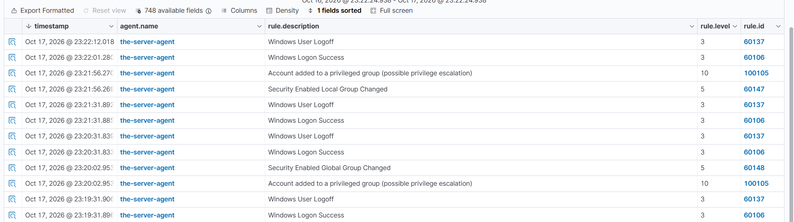
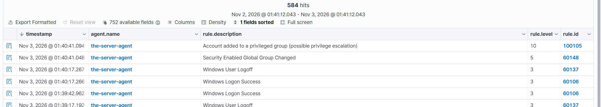

# Rule 100105 — Account Added to a Privileged Group

*Part of [Custom Detection Rules — Master Reference](README.md). Status: **TESTED** (Oct 17, 2026).*

| Field | Value |
|---|---|
| Rule ID | 100105 |
| Level | 10 |
| Event | 4728 / 4732 / 4756 (member added to a security-enabled group) |
| MITRE | **T1098** — Account Manipulation |
| Group | `privilege_escalation` |
| Source | Rule pack (`local_rules.xml`, 100100–100108); Lab 01 |

## Rule

```xml
<rule id="100105" level="10">
  <if_group>windows</if_group>
  <field name="win.system.eventID">^4728$|^4732$|^4756$</field>
  <field name="win.eventdata.targetUserName">Domain Admins|Enterprise Admins|Administrators|Schema Admins|Domain-Admins-Custom</field>
  <description>Account added to a privileged group (possible privilege escalation)</description>
  <mitre>
    <id>T1098</id>
  </mitre>
  <group>privilege_escalation,</group>
</rule>
```

## What it detects

An account (user or nested group) added to a **privileged** group — Domain Admins, Enterprise Admins, Administrators, Schema Admins, or the lab's own `Domain-Admins-Custom`. Adding someone to a privileged group is privilege escalation: the moment the membership is granted, the power rides with the identity.

## Purpose

The built-in rule 60141 fires at level 5 on **every** 4728, whether the group is `GG-Sales` or `Domain Admins`. Those two are not the same event. This rule narrows to the dangerous subset — privileged destinations only — and fires louder (level 10). It is the first custom rule of the lab, and the one that taught the shadowing lesson.

## How it works

- **`<if_group>windows</if_group>`** — only events decoded by the Windows decoder are evaluated.
- **`<field name="win.system.eventID">^4728$|^4732$|^4756$</field>`** — the event must be a member-add to a security-enabled group: 4728 (global), 4732 (local), or 4756 (universal). All three scopes are covered, so an attacker cannot dodge the rule by choosing a different group scope.
- **`<field name="win.eventdata.targetUserName">Domain Admins|Enterprise Admins|Administrators|Schema Admins|Domain-Admins-Custom</field>`** — the destination group must be a privileged one. This is the key design choice: the rule checks **where** the member was added (the target group), not **who** was added (the member). A normal group (`GG-Sales`) does not match, so routine membership changes stay silent.
- **`<mitre><id>T1098</id></mitre>`** — MITRE T1098 (Account Manipulation). The `<mitre>` element takes `<id>` only — a `<tactic>` or `<technique>` element inside it will prevent the manager from starting (learned the hard way: v1 of this pack crashed analysisd).
- **Level 10** — double the built-in's level 5, expressing that a privileged-group addition is a privilege-escalation event, not a routine membership change.

## Shadowing and dependencies

- **Shadows built-in 60141** on privileged group adds. Proven Oct 17, 2026 by a controlled experiment: removed the custom rules → re-ran the 4728 → 60141 fired; restored the custom rules → re-ran the same 4728 → 60141 silent, only 100105 fired. Shadowing only happens on match — a 4728 to a normal group still fires 60141.
- **Parent of 100111.** The Lab 03 correlation rule chains on 100105, not on 60141, precisely because 60141 never fires on privileged 4728s. If 100105 is ever removed, 100111 goes blind with it.
- **Does not depend on any parent.** Independent rule.

## Test evidence

**TESTED Oct 17, 2026** (Lab 01):

- **Positive:** created `labuser01` and added them to `Domain-Admins-Custom` → **100105 fired at level 10** (Oct 17 ~01:30 PKT).
- **Negative:** added the same user to `GG-Sales` (a normal group) → **100105 stayed silent**, and built-in **60141 fired at level 5**. Coverage is preserved — every 4728 gets exactly one alert.
- **Nesting test:** added an entire group (`Privileged-Users`) as a member of `Domain Admins` → **100105 still fired**, proving the rule checks the destination (WHERE), not the member (WHO). Whether an attacker adds a user or nests a whole group, the rule catches it.
- **Chain-lab re-confirmation (Nov 3–5, 2026):** `svc-backup` added to `Domain-Admins-Custom` → 100105 fired at L10 (Nov 3 01:40:41), 60141 absent — shadowing reconfirmed. `svc-chain02` added to the same group Nov 5 (user-confirmed; no screenshot of that run exists — the chain README carries the Nov 3 screenshot, clearly labelled as the earlier run).



*100105 at level 10, Oct 17 23:21:56 and 23:20:02 — "Account added to a privileged group (possible privilege escalation)". The Lab 01 positive test: labuser01 added to Domain-Admins-Custom.*

---



*100105 at level 10, Nov 3 01:40:41.094 — svc-backup added to Domain-Admins-Custom (chain-lab step 2). Built-in 60141 is absent from the list: shadowing reconfirmed.*

---

## Find it in Wazuh

```
rule.id: 100105
```

**One account, one group:**
```
data.win.system.eventID: 4728 AND data.win.eventdata.targetUserName: Domain-Admins-Custom
```

## MITRE ATT&CK

**T1098 — Account Manipulation.** Adversaries add accounts to privileged groups to gain persistent elevated access. Group membership is the privilege — the moment it is granted, the account can use it, and the change is visible in exactly one event (4728/4732/4756).
