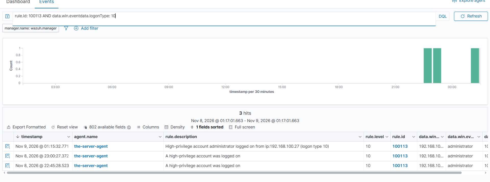

# Rule 100113 — High-Privilege Account Logged On

*Part of [Custom Detection Rules — Master Reference](README.md). Status: **TESTED** (Nov 8–9, 2026).*

| Field | Value |
|---|---|
| Rule ID | 100113 |
| Level | 10 |
| Event | 4624 (successful logon), logon types 2 / 3 / 10, target SID ending -500 |
| MITRE | **T1078** — Valid Accounts |
| Group | `privilege_escalation` |
| Source | Lab 04 (final version — Kali source of truth; see the version note below) |

## Rule

```xml
<rule id="100113" level="10">
  <if_group>windows</if_group>
  <field name="win.system.eventID">^4624$</field>
  <field name="win.eventdata.logonType">^2$|^3$|^10$</field>
  <field name="win.eventdata.targetUserSid">-500$</field>
  <description>High-privilege account $(win.eventdata.targetUserName) logged on from ip:$(win.eventdata.ipAddress) (logon type $(win.eventdata.logonType))</description>
  <mitre>
    <id>T1078</id>
  </mitre>
  <group>privilege_escalation,</group>
</rule>
```

> **Version note:** this is the **final** version as deployed on the manager (Kali `local_rules.xml`). The copy in the Lab 04 folder (`local_rules-100113-100114.xml`) predates the test and carries the original description ("A high-privilege account was logged on"). The only difference is the description — the matching fields are identical. The description was upgraded during testing (Nov 8, 2026) to render the username, IP, and logon type, matching the built-in RDP rule 92653's message style.

## What it detects

The **built-in Administrator account logging on** — console (type 2), network (type 3), or RDP (type 10). The most powerful account in the domain, authenticating, with the source IP attached.

## Purpose

The built-in rule 60106 fires on every 4624 and says nothing about privilege. This rule isolates the one logon that matters most: the Administrator. When that account logs on, the SOC should know immediately, with the source IP, because a compromised Administrator is a compromised domain.

## How it works

- **`<if_group>windows</if_group>`** — only events decoded by the Windows decoder are evaluated.
- **`<field name="win.system.eventID">^4624$</field>`** — the event must be a successful logon (4624).
- **`<field name="win.eventdata.logonType">^2$|^3$|^10$</field>`** — the logon type must be 2 (console), 3 (network), or 10 (RDP). Service (5) and cached (11) logons are out of scope by design.
- **`<field name="win.eventdata.targetUserSid">-500$</field>`** — the logging-on account's SID must end in **`-500`**, the well-known RID of the built-in Administrator. SID-based, rename-proof (the Lab 02 lesson): if the account is renamed, this rule still fires.
- **`<description>` with `$(win.eventdata.*)` substitution** — the alert renders the actual username, source IP, and logon type from the event (e.g. "High-privilege account administrator logged on from ip:192.168.100.27 (logon type 10)"). The same substitution pattern the built-in 92653 uses.
- **Level 10** — high, because the Administrator logging on is the event the whole domain's security depends on.

## Shadowing and dependencies

- **Shadows built-in 60106 on Administrator logons.** Verified Nov 8 23:17 PKT: `rule.id: 60106 AND data.win.eventdata.ipAddress: 192.168.100.27` returned nothing — 60106 stays silent on human logons. Machine logons still fire 60106 (coverage preserved).
- **Shadows built-in 92653 on RDP logons.** 92653 last fired Nov 8 18:08, before this rule loaded. After loading, every RDP logon fired 100113/100114 and 92653 went silent. That breaks rule 100112, which chains on 92653 — see the 100112 file.
- **Mutually exclusive with 100114.** 100114 negates `-500$`, so one logon fires exactly one of them — never both, never neither (for a human account).
- **No parent.** Independent rule.

## The known limit

This rule catches the **Administrator account** only. It does **not** catch a normal account that happens to be a member of a privileged group — `svc-chain02` is in `Domain-Admins-Custom`, but its own SID ends in `-1141`, so this rule does not fire for it and 100114 does (calling it "normal"). That is wrong for the chain scenario, and the reason is structural: **group membership is not a field on the 4624 event**. The proper fix is a correlation rule on **4672** (Special Privileges Assigned to New Logon): when a privileged-group member logs on, Windows fires 4672 with the same Logon ID. Chaining 4624 to a recent 4672 for the same Logon ID would catch every privileged logon, group membership included. That follow-up needs the 4672 rule ID verified first (Phase 2 sheet, still "verify in lab").

## Test evidence

**TESTED Nov 8–9, 2026** (Lab 04):

- **Positive — type 10:** fresh RDP as Administrator (after `logoff` of the existing session) → **100113 fired at 01:15:32.771** on Nov 9, new description rendering.



*Query `rule.id: 100113 AND data.win.eventdata.logonType: 10` — the type-10 row at 01:15:32.771 with the new description, above the two old-description type-10 rows (23:00:27, 22:45:28).*

---
- **Positive — type 3:** network logons as Administrator at 01:15:31, 01:13:10, 01:04:44, 00:21:18 → 100113 fired on each.
- **Positive — type 2:** console logons from 127.0.0.1 at 01:19:12, 01:10:51 → 100113 fired.
- **Negative — normal user:** logons as `svc-chain02` → **100114 fired, 100113 stayed silent** (correct — wrong SID).
- **Negative — machine account:** computer-account logons (`WIN-SOCLAB$`) → **neither** 100113 nor 100114; 60106 still fired (coverage preserved).
- **Shadowing:** 60106 silent on human logons (IP query); 92653 silent after load (last fired Nov 8 18:08).
- **Descriptions:** new 92653-style descriptions confirmed rendering from Nov 9 00:14 onward.
- **The type-10 lesson:** the first RDP attempts after 23:44 produced only type 3s — no type 10 — because the session already existed (`query session` showed it `Active`). After `logoff` + fresh RDP, the type 10 fired. A missing type 10 means the session already exists; check `query session` before blaming the rule.

## Find it in Wazuh

```
rule.id: 100113
```

## MITRE ATT&CK

**T1078 — Valid Accounts.** A logon with the built-in Administrator's valid credentials. The technique is the logon itself; the privilege is what the level expresses — this is the account whose compromise means the domain.
