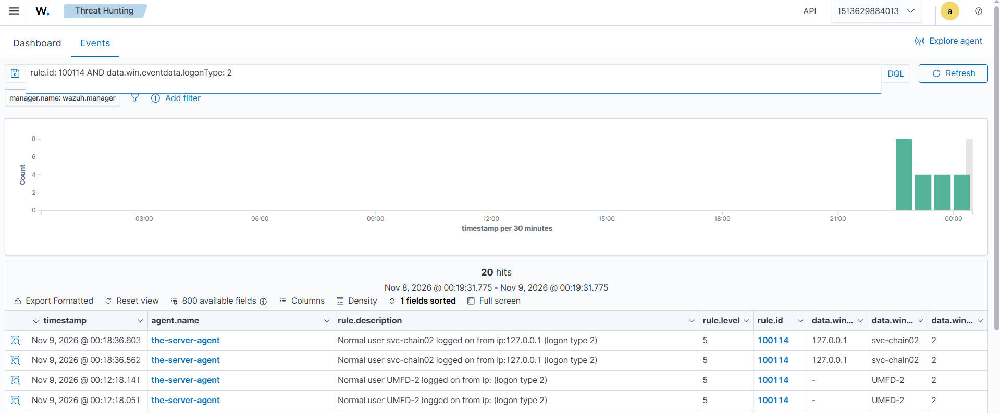
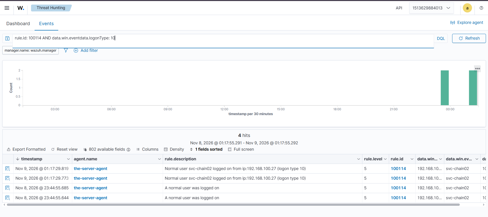

# Rule 100114 — Normal Human User Logged On

*Part of [Custom Detection Rules — Master Reference](README.md). Status: **TESTED** (Nov 8–9, 2026).*

| Field | Value |
|---|---|
| Rule ID | 100114 |
| Level | 5 |
| Event | 4624 (successful logon), logon types 2 / 3 / 10, human accounts only (by exclusion) |
| MITRE | **T1078** — Valid Accounts |
| Group | `authentication_success` |
| Source | Lab 04 (final version — Kali source of truth; see the version note below) |

## Rule

```xml
<rule id="100114" level="5">
  <if_group>windows</if_group>
  <field name="win.system.eventID">^4624$</field>
  <field name="win.eventdata.logonType">^2$|^3$|^10$</field>
  <field name="win.eventdata.targetUserName" negate="yes">\$$</field>
  <field name="win.eventdata.targetUserName" negate="yes">^SYSTEM$</field>
  <field name="win.eventdata.targetUserName" negate="yes">^UMFD-</field>
  <field name="win.eventdata.targetUserSid" negate="yes">-500$</field>
  <field name="win.eventdata.targetUserSid" negate="yes">^S-1-5-90-</field>
  <field name="win.eventdata.targetUserSid" negate="yes">^S-1-5-7$</field>
  <field name="win.eventdata.targetUserSid" negate="yes">^S-1-5-19$</field>
  <field name="win.eventdata.targetUserSid" negate="yes">^S-1-5-20$</field>
  <description>Normal user $(win.eventdata.targetUserName) logged on from ip:$(win.eventdata.ipAddress) (logon type $(win.eventdata.logonType))</description>
  <mitre>
    <id>T1078</id>
  </mitre>
  <group>authentication_success,</group>
</rule>
```

> **Version note:** this is the **final** version as deployed on the manager (Kali `local_rules.xml`). The copy in the Lab 04 folder (`local_rules-100113-100114.xml`) predates the test: it carries the original description ("A normal user was logged on") and only the original three negates (`\$$`, `^SYSTEM$`, `-500$`). The final version adds the DWM/UMFD negates (below) and the new description. The matching fields are otherwise identical. The Lab 04 folder copy should be synced to this version — see the open items in the Lab 04 index entry.

## What it detects

A **normal human user logging on** — console (type 2), network (type 3), or RDP (type 10) — with computer accounts, SYSTEM, virtual accounts, and the Administrator excluded. The human half of the 4624 flood, separated from the machine noise.

## Purpose

The built-in rule 60106 fires on every 4624 and says nothing about who logged on. This rule is the other half of the Lab 04 split: 100113 takes the Administrator, this rule takes every other **human** account. Together they turn the flood into two readable streams — privileged and normal — while machine logons keep firing 60106 underneath.

## How it works

- **`<if_group>windows</if_group>`** — only events decoded by the Windows decoder are evaluated.
- **`<field name="win.system.eventID">^4624$</field>`** — the event must be a successful logon (4624).
- **`<field name="win.eventdata.logonType">^2$|^3$|^10$</field>`** — the logon type must be 2 (console), 3 (network), or 10 (RDP).
- **The negates — human-only by exclusion.** Each `negate="yes"` field is a condition the event must **not** match. The rule is built by carving away everything that is not a person:
  - `targetUserName` **not** `\$$` — computer accounts end in `$` (`WIN-SOCLAB$`). Excludes machines.
  - `targetUserName` **not** `^SYSTEM$` — SYSTEM is not a person.
  - `targetUserName` **not** `^UMFD-` — UMFD-2 and friends are Windows font-driver virtual accounts (added Nov 9, 2026 after the UMFD-2 false positive).
  - `targetUserSid` **not** `-500$` — the Administrator belongs to 100113. This negate is what makes the two rules mutually exclusive.
  - `targetUserSid` **not** `^S-1-5-90-` — the Desktop Window Manager (DWM-1, DWM-2, DWM-3…), which spawns a 4624 on every interactive/RDP logon (added Nov 8, 2026 after the DWM flood).
  - `targetUserSid` **not** `^S-1-5-7$` — ANONYMOUS LOGON (added preemptively with the DWM fix).
  - `targetUserSid` **not** `^S-1-5-19$` — LOCAL SERVICE (added preemptively with the DWM fix).
  - `targetUserSid` **not** `^S-1-5-20$` — NETWORK SERVICE (added preemptively with the DWM fix).
- **`<description>` with `$(win.eventdata.*)` substitution** — the alert renders the actual username, source IP, and logon type (e.g. "Normal user svc-chain02 logged on from ip:192.168.100.27 (logon type 3)").
- **Level 5** — low, deliberately. A normal user logging on is routine; the rule's job is visibility and triage, not alarm. The privilege is what the level expresses, and this tier has none.

## Shadowing and dependencies

- **Shadows built-in 60106 on human logons** (with 100113). Verified Nov 8 23:17 PKT by IP query. Machine logons still fire 60106.
- **Shadows built-in 92653 on RDP logons** (with 100113). Last 92653 firing Nov 8 18:08; silent after load.
- **Mutually exclusive with 100113.** The `-500$` negate guarantees one logon fires exactly one of them.
- **No parent.** Independent rule.

## False positives found while testing

### DWM flood (Nov 8, 2026)

100114 fired on a flood of `DWM-1`, `DWM-2`, `DWM-3` logons — the Desktop Window Manager spawns a session (and a 4624) on every interactive/RDP logon. The document detail proved it: SID `S-1-5-90-0-3`, Virtual Account `Yes`, process `winlogon.exe`. **Fix:** the four SID negates (`^S-1-5-90-`, `^S-1-5-7$`, `^S-1-5-19$`, `^S-1-5-20$`).

### UMFD-2 (Nov 9, 2026)

**UMFD-2**, a font-driver virtual account, fired 100114 as "Normal user UMFD-2 logged on from ip: (logon type 2)" — empty IP, never over the network. **Fix:** the `^UMFD-` negate on `targetUserName`. Confirmed gone Nov 9 ~01:01 PKT.



*Query `rule.id: 100114 AND data.win.eventdata.logonType: 2` — UMFD-2 firing 100114 as "Normal user UMFD-2 logged on from ip: (logon type 2)" (00:12:18, empty IP) next to real svc-chain02 type-2 logons from 127.0.0.1 (00:18:36).*

---

## Test evidence

**TESTED Nov 8–9, 2026** (Lab 04):

- **Positive — type 10:** fresh RDP as `svc-chain02` (after `logoff` of the existing session) → **100114 fired at 01:17:29.819** on Nov 9, new description rendering.



*Query `rule.id: 100114 AND data.win.eventdata.logonType: 10` — svc-chain02 type 10 at 01:17:29.819 and 01:17:29.773 with the new description, above the old-description rows (23:44:55).*

---
- **Positive — type 3:** network logons as `svc-chain02` at 01:17:28, 00:55:11, 00:28:39, 00:14:38 → 100114 fired on each.
- **Positive — type 2:** console logons from 127.0.0.1 at 01:21:19, 01:00:00 → 100114 fired.
- **Negative — Administrator:** logons as Administrator → **100113 fired, 100114 stayed silent** (correct — the `-500$` negate).
- **Negative — machine account:** computer-account logons (`WIN-SOCLAB$`) → **neither** custom rule; 60106 still fired.
- **Negative — DWM / UMFD-2:** after the fixes, type-2 results show only real console logons — DWM and UMFD-2 are gone.
- **Shadowing:** 60106 silent on human logons; 92653 silent after load.
- **Known limit (recorded, not a bug):** `svc-chain02` is in `Domain-Admins-Custom` but fires 100114 ("normal") — group membership is not a field on the 4624 event. The 4672-correlation follow-up is the fix; it needs the 4672 rule ID verified first.

## Find it in Wazuh

```
rule.id: 100114
```

## MITRE ATT&CK

**T1078 — Valid Accounts.** A logon with a normal user's valid credentials. The technique is the same as 100113; the level is lower because the account is not privileged — but a normal account logging on from an unusual IP at an unusual hour is still the first thing to check, and this rule is what makes it visible.
