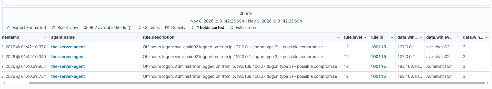
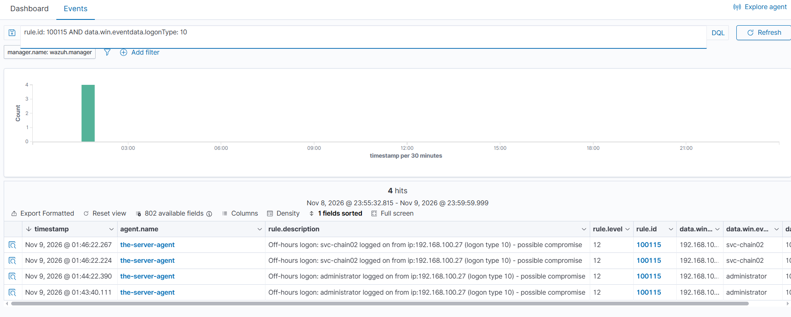

# Rule 100115 — Off-Hours Logon (Possible Compromise)

*Part of [Custom Detection Rules — Master Reference](README.md). Status: **TESTED** (Nov 9, 2026).*

| Field | Value |
|---|---|
| Rule ID | 100115 |
| Level | 12 |
| Event | 4624 (successful logon), logon types 2 / 3 / 10, human accounts only, off-hours |
| MITRE | **T1078** — Valid Accounts |
| Group | `authentication_success` |
| Source | Lab 05 |

## Rule

```xml
<rule id="100115" level="12">
  <if_group>windows</if_group>
  <field name="win.system.eventID">^4624$</field>
  <field name="win.eventdata.logonType">^2$|^3$|^10$</field>
  <field name="win.eventdata.targetUserName" negate="yes">\$$</field>
  <field name="win.eventdata.targetUserName" negate="yes">^SYSTEM$</field>
  <field name="win.eventdata.targetUserName" negate="yes">^UMFD-</field>
  <field name="win.eventdata.targetUserSid" negate="yes">^S-1-5-90-</field>
  <field name="win.eventdata.targetUserSid" negate="yes">^S-1-5-7$</field>
  <field name="win.eventdata.targetUserSid" negate="yes">^S-1-5-19$</field>
  <field name="win.eventdata.targetUserSid" negate="yes">^S-1-5-20$</field>
  <time>5 pm - 8 am</time>
  <description>Off-hours logon: $(win.eventdata.targetUserName) logged on from ip:$(win.eventdata.ipAddress) (logon type $(win.eventdata.logonType)) - possible compromise</description>
  <mitre>
    <id>T1078</id>
  </mitre>
  <group>authentication_success,</group>
</rule>
```

> **Revert-verification note:** the Kali copy of this rule was briefly flipped during the on-hours test on Nov 9, 2026 (the time window was changed to `8 am - 5 pm` for the 60122 test, then reverted with a global `sed`). The revert had a false step first — the flip command was re-run instead of the revert command, which flipped this rule's window instead of reverting 100116's. **Verify on the manager that all three time rules (100109, 100115, 100116) show `5 pm - 8 am`** — the revert was instructed but the final state was not confirmed in the session. The XML above is the intended final state.

## What it detects

**Any human account logging on outside business hours** — console (type 2), network (type 3), or RDP (type 10). Administrator or normal user, it does not matter: the timing is the signal. A logon at 3 AM is a possible compromise.

## Purpose

Rules 100113/100114 split logons by privilege; this rule splits them by **time**. A normal user logging on at noon is routine; the same user logging on at 3 AM is the pattern an attacker leaves behind. Level 12 — the highest of the three logon rules — expresses that off-hours access is the compromise indicator, regardless of whose account it is.

## How it works

- **`<if_group>windows</if_group>`** — only events decoded by the Windows decoder are evaluated.
- **`<field name="win.system.eventID">^4624$</field>`** — the event must be a successful logon (4624).
- **`<field name="win.eventdata.logonType">^2$|^3$|^10$</field>`** — the logon type must be 2 (console), 3 (network), or 10 (RDP). Same three human types as 100113/100114.
- **The seven negates — human-only by exclusion, same as 100114 minus the privilege split:**
  - `targetUserName` **not** `\$$` — computer accounts.
  - `targetUserName` **not** `^SYSTEM$` — SYSTEM is not a person.
  - `targetUserName` **not** `^UMFD-` — font-driver virtual accounts.
  - `targetUserSid` **not** `^S-1-5-90-` — Desktop Window Manager.
  - `targetUserSid` **not** `^S-1-5-7$` — ANONYMOUS LOGON.
  - `targetUserSid` **not** `^S-1-5-19$` — LOCAL SERVICE.
  - `targetUserSid` **not** `^S-1-5-20$` — NETWORK SERVICE.
  - **No `-500$` negate** — deliberately. This rule covers the Administrator too; the privilege split belongs to 100113/100114, not here. An off-hours Administrator logon fires both 100113 (level 10) and this rule (level 12).
- **`<time>5 pm - 8 am</time>`** — the event must occur between 5 PM and 8 AM, evaluated against the **manager's clock (UTC)** — 10 PM – 1 PM PKT. Same window as 100109 and 100116.
- **`<description>` with `$(win.eventdata.*)` substitution** — the alert renders the username, source IP, and logon type, plus the words "possible compromise" so the triage priority is visible in the alert list itself.
- **Level 12** — the highest of the logon rules, because the timing is the compromise signal.

## Shadowing and dependencies

- **No parent, no shadowing.** Independent rule. It fires *in addition* to 100113/100114 — an off-hours Administrator logon generates both a 100113 alert (level 10) and a 100115 alert (level 12). Two alerts, two angles: privilege and timing.
- **Does not shadow 60106 itself** — 100113/100114 already do that on human logons. This rule adds the time dimension on top.
- **Noise note (honest):** the lab analyst works at night, so this rule fires on his own late-night logons. That is expected and correct — the rule detects off-hours logons, and the analyst triages them as known-good. In a real SOC, off-hours admin logons are investigated; in this home lab, they are recognised and recorded. If the noise becomes unmanageable, the tuning options are excluding the analyst's known IP or narrowing the time window — not deleting the rule.

## Test evidence

**TESTED Nov 9, 2026** (Lab 05):

- **Positive:** Administrator RDP logon at **01:40:39** (Nov 9) → **100115 fired at level 12**, description rendering correctly: "Off-hours logon: Administrator logged on from ip:192.168.100.27 (logon type 3) - possible compromise". Two hits at 01:40:39.957 and 01:40:39.734.



*The first 100115 firing (level 12) — Administrator type 3 from 192.168.100.27 at 01:40:39.957 and 01:40:39.734, svc-chain02 type 2 from 127.0.0.1 at 01:42:10.372 and 01:42:10.340.*

---
- **Type 10 under 100115 — CONFIRMED Nov 9 01:43–01:46.** Administrator at 01:43:40.111 and 01:44:22.390, svc-chain02 at 01:46:22.224 and 01:46:22.267, all from 192.168.100.27 (L12, new description rendering). The 01:40 attempt was a session reconnection (type 3s only); fresh RDPs after it produced the type-10 rows. The rule's logonType field (`^2$|^3$|^10$`) is identical to 100113/100114's, which have both fired on type 10 — and 100115 has now fired on type 10 as well.



*Query `rule.id: 100115 AND data.win.eventdata.logonType: 10` — four type-10 rows under 100115 (level 12): administrator at 01:43:40 and 01:44:22, svc-chain02 at 01:46:22, all from 192.168.100.27.*

---

## Find it in Wazuh

```
rule.id: 100115
```

**Type 10 only:**
```
rule.id: 100115 AND data.win.eventdata.logonType: 10
```

## MITRE ATT&CK

**T1078 — Valid Accounts.** A logon with valid credentials outside business hours. The technique is the same as any logon; the timing is what makes it a compromise indicator — attackers work while the target is asleep, and a 3 AM logon by any account deserves a level-12 alert.
