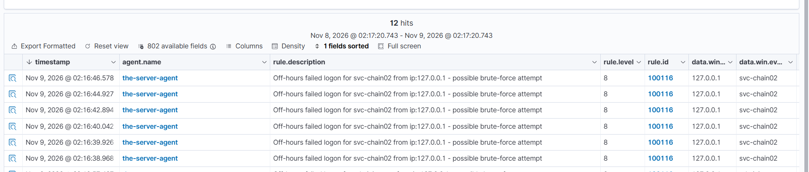
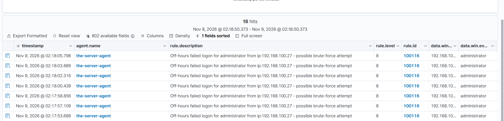
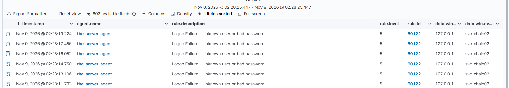

# Rule 100116 — Off-Hours Failed Logon (Possible Brute Force)

*Part of [Custom Detection Rules — Master Reference](README.md). Status: **TESTED** (Nov 9, 2026).*

| Field | Value |
|---|---|
| Rule ID | 100116 |
| Level | 8 |
| Event | 4625 (failed logon), off-hours, via parent rule 60122 |
| MITRE | **T1110** — Brute Force |
| Group | `authentication_failed` |
| Source | Lab 05 |

## Rule

```xml
<rule id="100116" level="8">
  <if_sid>60122</if_sid>
  <time>5 pm - 8 am</time>
  <description>Off-hours failed logon for $(win.eventdata.targetUserName) from ip:$(win.eventdata.ipAddress) - possible brute-force attempt</description>
  <mitre>
    <id>T1110</id>
  </mitre>
  <group>authentication_failed,</group>
</rule>
```

> **Revert-verification note:** the Kali copy of this rule was briefly flipped during the on-hours test on Nov 9, 2026 (the time window was changed to `8 am - 5 pm` to prove 60122 fires on-hours, then reverted with a global `sed`). The revert had a false step first — the flip command was re-run instead of the revert command. **Verify on the manager that all three time rules (100109, 100115, 100116) show `5 pm - 8 am`** — the revert was instructed but the final state was not confirmed in the session. The XML above is the intended final state.

## What it detects

A **failed logon outside business hours** — event 4625 between 5 PM and 8 AM UTC. One failure at 3 AM is not a typo; it is someone guessing passwords while the target sleeps.

## Purpose

The built-in rule 60122 fires at level 5 on every failed logon, including daytime typos. This rule is its off-hours child: the same failure, at the wrong hour, fires louder (level 8). It is the failed-logon half of the off-hours pair — 100115 catches the logon that succeeded at night, this rule catches the attempts that failed.

## How it works

- **`<if_sid>60122</if_sid>`** — the parent is the built-in failed-logon rule 60122. This event must first have fired 60122. The child inherits 60122's matching (any 4625) and adds only the time condition — no eventID, logonType, or account fields of its own.
- **`<time>5 pm - 8 am</time>`** — the event must occur between 5 PM and 8 AM, evaluated against the **manager's clock (UTC)** — 10 PM – 1 PM PKT. Same window as 100109 and 100115.
- **`<description>` with `$(win.eventdata.*)` substitution** — the alert renders the target username and source IP (e.g. "Off-hours failed logon for svc-chain-02 from ip:192.168.100.27 - possible brute-force attempt").
- **Level 8** — above the parent's level 5, below the successful off-hours logon (100115 at 12). A failed attempt is less serious than a successful one — the attacker did not get in — but an off-hours failure is more serious than a daytime typo.

## Shadowing and dependencies

- **Shadows its parent 60122 during off-hours.** When this rule fires, 60122 stays silent — the child suppresses its parent on match. Proven Nov 9 02:23 PKT: after 100116 loaded, every failed logon fired 100116 only; `rule.id: 60122` showed just 4 old hits, latest 01:16:48 (before 100116 existed). The recent attempts (02:07–02:18) were all under 100116.
- **60122 fires again on-hours.** When 100116 does not match (wrong time window), the parent carries the detection. Proven by the time-flip test (below).
- **Depends on 60122.** If 60122 stops firing, this rule can never fire. 60122 is a built-in rule and is not shadowed by anything except this rule itself (during off-hours only), so the dependency is safe.
- **Interaction with 100100/100101:** those frequency rules also count 60122 hits. During off-hours, 100116 suppresses 60122, so their counters may starve at night. See the 100100 file.

## Test evidence

**TESTED Nov 9, 2026** (Lab 05):

- **Positive (off-hours):** failed logons for `svc-chain02` (02:07:37–02:09:49, from 192.168.100.27) and `administrator` (02:17:53–02:18:05, from 192.168.100.27; plus 01:43:30) → **100116 fired at level 8** on each, description rendering correctly.



*Rule 100116 (level 8) firing on failed logons for svc-chain02, 02:16:38–02:16:46, from 127.0.0.1 — 12 hits in the window.*

---



*Rule 100116 (level 8) firing on failed logons for administrator, 02:17:53–02:18:05, from 192.168.100.27 — 18 hits in the window.*

---
- **Shadowing confirmed:** after 100116 loaded (~01:40), no new 60122 hits — latest 60122 was 01:16:48. All 02:07–02:18 attempts are under 100116.
- **Time-flip test (on-hours proof, Nov 9 02:28–02:31 PKT):** 100116's window was temporarily flipped to `8 am - 5 pm`. New failed logons then fired **60122** (svc-chain02, 127.0.0.1, 02:28:11–02:31:09) and 100116 stopped firing for new attempts. On-hours behaviour confirmed. The window was reverted to `5 pm - 8 am` afterwards (see the revert note above).



*After 100116's window was flipped to `8 am - 5 pm`, new failed logons fired the built-in 60122 ("Logon Failure — Unknown user or bad password", level 5) instead — svc-chain02, 127.0.0.1, 02:28:11–02:28:19.*

---
- **Lockouts during testing:** both accounts locked out (rule 60115, level 9) at 02:10:55 (Administrator), 02:16:44 (svc-chain02), 02:18:02 (Administrator). Lockout policy: threshold 5 attempts, duration 30 minutes, observation window 30 minutes — the accounts auto-unlocked after 30 minutes.
- **Failed RDP is always type 3:** every failed RDP attempt in this testing recorded logonType 3, never 10 — a failed authentication never creates a session, so Windows records the 4625 as a network failure. Type 10 only exists when the logon succeeds. The `logoff` trick does not apply to failed logons (no session to clear).

## Find it in Wazuh

```
rule.id: 100116
```

## MITRE ATT&CK

**T1110 — Brute Force.** Repeated failed logons are password guessing in progress. The off-hours window is what makes this rule different from 60122: guessing at 3 AM means the attacker chose the hour when nobody is watching, and the level-8 alert says so.
