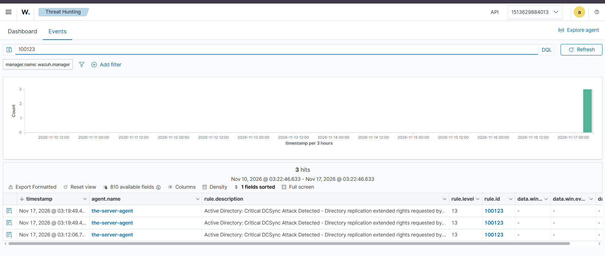

# Rule 100123 — Non-DC Directory Service Replication (DCSync Attack)

*Part of [Custom Detection Rules — Master Reference](README.md). Status: **TESTED**.*

| Field | Value |
|---|---|
| Rule ID | 100123 |
| Level | 13 |
| Event | 4662 (An operation was performed on an object), Access Mask `0x100` |
| MITRE | **T1003.006** — OS Credential Dumping: DCSync |
| Group | `windows,kerberos,active_directory` |
| Source | Lab 13 (`local_rules.xml`, 100123–100125) |

## Rule

```xml
<rule id="100123" level="13">
  <if_sid>60103</if_sid>
  <field name="win.system.eventID">^4662$</field>
  <field name="win.eventdata.accessMask">0x100</field>
  <field name="win.eventdata.subjectUserName" negate="yes">.*\$</field>
  <description>Active Directory: Potential DCSync Attack - Directory replication extended rights requested by non-DC account $(win.eventdata.subjectUserName)</description>
  <mitre>
    <id>T1003.006</id>
  </mitre>
</rule>
```

## What it detects

Non-machine accounts requesting Active Directory Directory Service replication rights (`AccessMask: 0x100` — Control Access) on Active Directory domain objects. In a standard enterprise domain, directory synchronization via the Microsoft Directory Replication Service Remote Protocol (MS-DRSR / DRSUAPI) occurs strictly between authorized Domain Controllers (accounts whose names terminate with `$`, such as `WIN-SOCLAB$`). When a user account or an unmanaged host requests these extended replication rights, it signals an adversary utilizing tools like `impacket-secretsdump` or `mimikatz` to harvest master password hashes directly from Active Directory.

## Purpose

Event 4662 is notoriously noisy when Directory Service Access auditing is broadly enabled. However, replication requests targeting directory secrets always carry specific attributes:
1. `AccessMask`: `0x100` (`Control Access` / Extended Rights).
2. `SubjectUserName`: In an attack scenario, the requester is a compromised administrative or delegated user account (e.g., `administrator`, `svc-syncadmin`), NOT a machine account (`.*\$`).

Filtering out legitimate Domain Controller computer accounts isolates DRSUAPI credential dumping with near-zero false positives, firing at **Level 13** (Critical Security Alert).

## How it works

- **`<if_sid>60103</if_sid>`** — inherits from the baseline Windows generic event rule (Event ID 4662).
- **`<field name="win.system.eventID">^4662$</field>`** — matches Windows Security Event 4662 (`An operation was performed on an object`).
- **`<field name="win.eventdata.accessMask">0x100</field>`** — restricts detection to extended rights access (`0x100` represents `RIGHT_DS_CONTROL_ACCESS`).
- **`<field name="win.eventdata.subjectUserName" negate="yes">.*\$</field>`** — suppresses alerts for legitimate Domain Controllers, which invariably authenticate using machine accounts ending in `$`.
- **Level 13** — critical severity, indicating that domain credentials (including the `krbtgt` master encryption key) have been remotely harvested.

## Shadowing and dependencies

- **Parent Rule:** Inherits from `60103` (Windows Event baseline).
- **Shadowing:** Shadows generic Event 4662 alerts when the requester is a human or service user account. Legitimate DC-to-DC replication continues to fall through to lower-priority audit logging.
- **Prerequisites:** Requires **Directory Service Access** auditing enabled (`Audit Directory Service Access: Success` via GPO) on the Domain Controller.

## Test evidence

**TESTED** — verified live in [Lab 13 — Golden Ticket (TGT Forgery) & DCSync Detection Lab](../01-Core-Detection-Labs/02-Kerberos-Attacks-and-Defense-Labs/13-Golden-Ticket-TGT-Forgery-and-DCSync/) on November 17, 2026.

1. **Adversary Emulation:** Kali Linux (`192.168.100.50`) executed `impacket-secretsdump -just-dc-user krbtgt` targeting Domain Controller `WIN-SOCLAB.soclab.local` (`192.168.100.146`) using elevated user account `svc-syncadmin`.
2. **SIEM Detection:** Wazuh fired Rule **100123** at **Level 13** immediately upon receipt of Event 4662:
   - `SubjectUserName`: `svc-syncadmin`
   - `AccessMask`: `0x100`
   - `ObjectType`: `%{19195a5b-6da0-11d0-afd3-00c04fd930c9}` (`domainDNS`)
   - `Properties`: `1131f6aa-9c07-11d1-f79f-00c04fc2dcd2` (`DS-Replication-Get-Changes-All`)


*Figure: Wazuh Discover dashboard confirming Rule 100123 firing at Level 13 during DCSync replication extraction.*

## Find it in Wazuh

```
rule.id: 100123
```

## MITRE ATT&CK

**T1003.006 — OS Credential Dumping: DCSync.** Adversaries may attempt to access credentials by using the Directory Replication Service (DRS) Remote Protocol to mimic a Domain Controller and request account hashes directly from another Domain Controller. This technique bypasses host-based LSASS monitoring entirely because secrets are transmitted over standard remote RPC.
