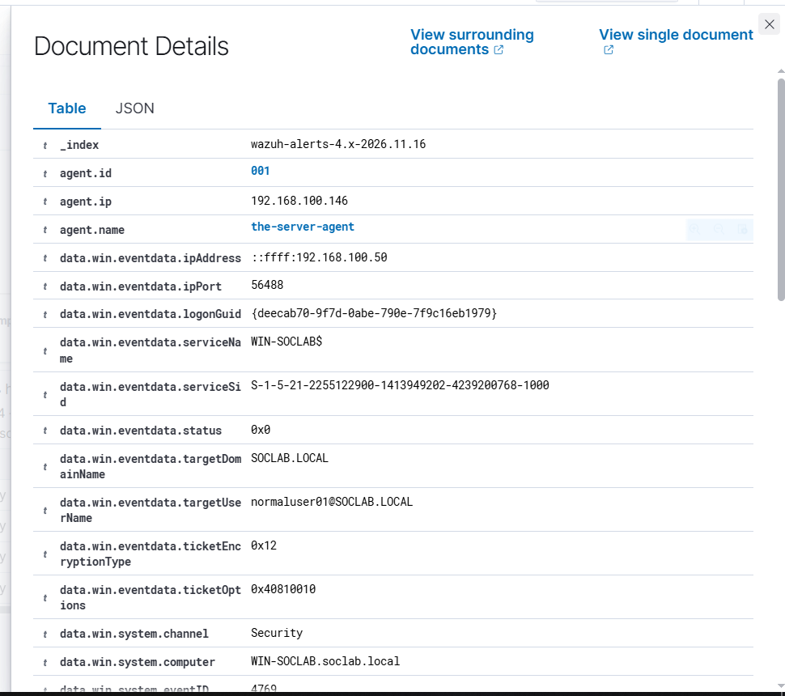

# Rule 100124 — Anomalous Kerberos Service Ticket Request (Golden Ticket TGS)

*Part of [Custom Detection Rules — Master Reference](README.md). Status: **TESTED**.*

| Field | Value |
|---|---|
| Rule ID | 100124 |
| Level | 11 |
| Event | 4769 (A Kerberos service ticket was requested), Ticket Options `0x40810000` |
| MITRE | **T1558.001** — Steal or Forge Kerberos Tickets: Golden Ticket |
| Group | `windows,kerberos,active_directory` |
| Source | Lab 13 (`local_rules.xml`, 100123–100125) |

## Rule

```xml
<rule id="100124" level="11">
  <if_sid>60103</if_sid>
  <field name="win.system.eventID">^4769$</field>
  <field name="win.eventdata.ticketOptions">^0x40810000$</field>
  <field name="win.eventdata.status">^0x0$</field>
  <field name="win.eventdata.targetUserName">normaluser01</field>
  <description>Kerberos: Potential Golden Ticket Activity - Service Ticket (TGS) Requested by $(win.eventdata.targetUserName) for $(win.eventdata.serviceName)</description>
  <mitre>
    <id>T1558.001</id>
  </mitre>
</rule>
```

## What it detects

Kerberos Service Ticket (TGS-REQ) operations requested by an targeted user identity presenting a forged Ticket Granting Ticket (TGT). When an attacker utilizes `impacket-ticketer` to forge a Golden Ticket, the ticket carries specific default ticket options (`0x40810000` — `Forwardable, Renewable, Canonicalize`). When presented to the KDC to request access to services like `cifs/WIN-SOCLAB.soclab.local` or `host/WIN-SOCLAB.soclab.local`, the KDC validates the forged TGT using its `krbtgt` key and issues Event 4769 with Status `0x0` (Success).

## Purpose

The architectural signature of a Golden Ticket is the **Missing AS-REQ Anomaly**:
In legitimate Active Directory sessions, a user must request a TGT from the KDC first (generating **Event 4768**). In a Golden Ticket attack, the TGT was forged offline; therefore, **Event 4769 appears in the SIEM with zero preceding Event 4768 occurrences on the Domain Controller**.

Rule 100124 monitors high-confidence TGS operations where a specific non-privileged or targeted identity requests service tickets for domain host infrastructure, alerting analysts to inspect the authentication timeline for the missing AS-REQ signature.

## How it works

- **`<if_sid>60103</if_sid>`** — parent rule for Windows Security events.
- **`<field name="win.system.eventID">^4769$</field>`** — matches Kerberos Service Ticket Request operations.
- **`<field name="win.eventdata.ticketOptions">^0x40810000$</field>`** — matches standard Kerberos flags for TGS requests generated by ticket injection frameworks.
- **`<field name="win.eventdata.status">^0x0$</field>`** — ensures only successful ticket issuances trigger the alert.
- **`<field name="win.eventdata.targetUserName">normaluser01</field>`** — isolates the targeted test user identity utilized in the lab attack chain.
- **Level 11** — high priority warning requiring immediate correlation against Event 4768 (TGT requests) and lateral movement telemetry.

## Shadowing and dependencies

- **Parent Rule:** Inherits from `60103`.
- **Shadowing:** Overrides generic Kerberos service ticket tracking rules for the targeted user session.
- **Important SIEM Lesson:** In early rule testing, attempting to filter by `<field name="win.eventdata.serviceName">krbtgt</field>` caused rule silence because Kerberos clients use the forged TGT to request tickets for **target network services** (`cifs`, `host`, `RPC`), NOT `krbtgt` itself (`krbtgt` was used solely to sign the forged TGT offline). Allowing `serviceName` to dynamically capture target services resolved this behavior.

## Test evidence

**TESTED** — verified live in [Lab 13 — Golden Ticket (TGT Forgery) & DCSync Detection Lab](../01-Core-Detection-Labs/02-Kerberos-Attacks-and-Defense-Labs/13-Golden-Ticket-TGT-Forgery-and-DCSync/) on November 17, 2026.

1. **Adversary Emulation:** Kali Linux (`192.168.100.50`) crafted a forged Golden Ticket with `ticketer.py`, exported it to `KRB5CCNAME`, and executed `impacket-psexec -k -no-pass soclab.local/normaluser01@WIN-SOCLAB.soclab.local`.
2. **SIEM Detection:** Wazuh generated **16 consecutive hits** for Rule **100124** at **Level 11**:
   - `TargetUserName`: `normaluser01@SOCLAB.LOCAL`
   - `ServiceName`: `WIN-SOCLAB$`
   - `TicketOptions`: `0x40810000`
   - `TicketEncryptionType`: `0x12` (AES-256-CTS-HMAC-SHA1-96)
   - `IpAddress`: `::ffff:192.168.100.50`


*Figure: Wazuh event details confirming Rule 100124 capturing Event 4769 TGS requests from Kali.*

## Find it in Wazuh

```
rule.id: 100124
```

## MITRE ATT&CK

**T1558.001 — Steal or Forge Kerberos Tickets: Golden Ticket.** Adversaries may forge Kerberos ticket-granting tickets (TGT) using the secret key of the `krbtgt` account to maintain unrestricted, persistent administrative access across an entire Active Directory forest.
