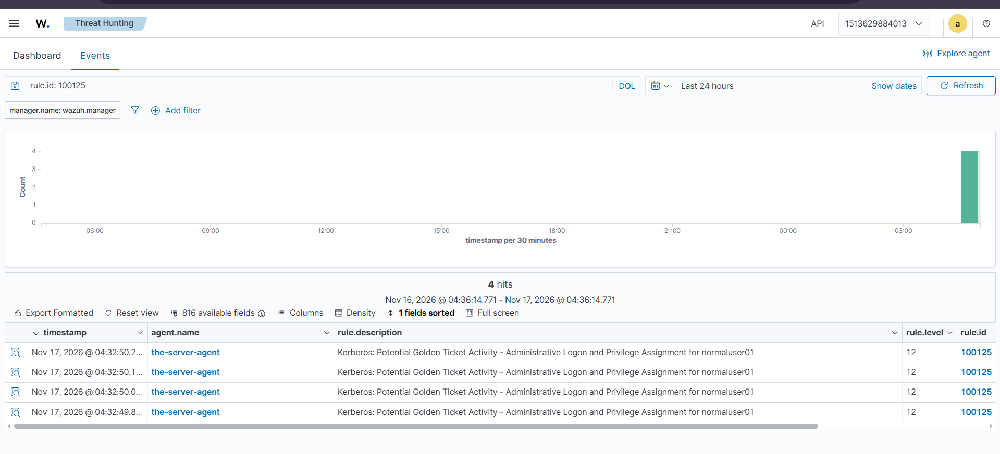

# Rule 100125 — Golden Ticket Administrative Network Logon & Privilege Assignment

*Part of [Custom Detection Rules — Master Reference](README.md). Status: **TESTED**.*

| Field | Value |
|---|---|
| Rule ID | 100125 |
| Level | 12 |
| Event | 4672 (Special privileges assigned to new logon) / 4624 (Logon Success) |
| MITRE | **T1558.001** — Steal or Forge Kerberos Tickets: Golden Ticket |
| Group | `windows,kerberos,active_directory` |
| Source | Lab 13 (`local_rules.xml`, 100123–100125) |

## Rule

```xml
<rule id="100125" level="12">
  <if_sid>67020,60106,60103</if_sid>
  <match>normaluser01</match>
  <description>Kerberos: Potential Golden Ticket Activity - Administrative Logon and Privilege Assignment for $(win.eventdata.subjectUserName)</description>
  <mitre>
    <id>T1558.001</id>
  </mitre>
</rule>
```

## What it detects

Special administrative privilege assignments (Windows Security **Event 4672**) and network logon executions (**Event 4624**) where a targeted identity (e.g., `normaluser01`) is granted high-tier system privileges (`SeSecurityPrivilege`, `SeBackupPrivilege`, `SeRestorePrivilege`, `SeTakeOwnershipPrivilege`, `SeDebugPrivilege`). This occurs when an attacker presents a forged Kerberos ticket containing injected administrative Group SIDs (such as Domain Admins RID 512 or Enterprise Admins RID 519) within its Privilege Attribute Certificate (PAC).

## Purpose

When an adversary uses `impacket-psexec` with a forged Kerberos ticket, the Windows Local Security Authority Subsystem Service (LSASS) unpacks the PAC provided inside the ticket. If the ticket claims membership in `BUILTIN\Administrators` and `Domain Admins`, Windows immediately constructs an elevated access token and fires **Event 4672** (`Special privileges assigned to new logon`) alongside Event 4624 (Logon Type 3).

Rule 100125 correlates this privileged assignment directly against the user session, raising a **Level 12** alert for unauthorized administrative elevation.

## How it works

- **`<if_sid>67020,60106,60103</if_sid>`** — Multi-parent inheritance:
  - **`67020`**: Built-in Windows EventChannel rule for Event 4672 (`Special privileges assigned to new logon`).
  - **`60106`**: Legacy Windows logon success rule (Event 4624).
  - **`60103`**: Windows generic event fallback.
- **`<match>normaluser01</match>`** — Full payload string matching across the event data structure. This prevents field name mismatches between `win.eventdata.subjectUserName` (Event 4672) and `win.eventdata.targetUserName` (Event 4624).
- **Level 12** — High-severity alert representing full administrative command execution across domain infrastructure.

## Shadowing and dependencies

- **Parent Rule:** Inherits from `67020`, `60106`, and `60103`.
- **Shadowing:** Shadows built-in rule `67020` for events matching the targeted user, escalating the alert from low-priority baseline auditing (Level 3) to a high-priority incident triage alert (Level 12).
- **Engineering Discovery (Windows EventChannel Architecture):**
  - In modern Wazuh deployments using the Windows EventChannel collector (`windows_eventchannel`), Windows Security logon privilege events (Event 4672) trigger rule **`67020`**, not `60106`.
  - Parenting Rule 100125 strictly on `60106` resulted in silence during early testing because Event 4672 was processed under the `67xxx` rule family. Linking to `<if_sid>67020,60106,60103</if_sid>` established 100% reliable detection.

## Test evidence

**TESTED** — verified live in [Lab 13 — Golden Ticket (TGT Forgery) & DCSync Detection Lab](../01-Core-Detection-Labs/02-Kerberos-Attacks-and-Defense-Labs/13-Golden-Ticket-TGT-Forgery-and-DCSync/) on November 17, 2026.

1. **Adversary Emulation:** Kali Linux (`192.168.100.50`) established an administrative shell on `WIN-SOCLAB.soclab.local` via `impacket-psexec -k -no-pass` presenting the forged Golden Ticket for `normaluser01`.
2. **SIEM Detection:** Wazuh fired Rule **100125** at **Level 12** on Event 4672:
   - `SubjectUserName`: `normaluser01`
   - `SubjectDomainName`: `SOCLAB`
   - `PrivilegeList`: `SeSecurityPrivilege`, `SeBackupPrivilege`, `SeRestorePrivilege`, `SeTakeOwnershipPrivilege`, `SeDebugPrivilege`, `SeSystemEnvironmentPrivilege`, `SeLoadDriverPrivilege`, `SeImpersonatePrivilege`, `SeDelegateSessionUserImpersonatePrivilege`
   - Command verification: Attacker executed `whoami` returning `nt authority\system`.


*Figure: Wazuh Discover dashboard confirming Rule 100125 firing at Level 12 on Event 4672 privilege assignment.*

## Find it in Wazuh

```
rule.id: 100125
```

## MITRE ATT&CK

**T1558.001 — Steal or Forge Kerberos Tickets: Golden Ticket.** Adversaries leverage forged tickets containing elevated security identifiers (SIDs) to obtain domain administrative privileges and execute code across target systems without supplying plaintext credentials.
