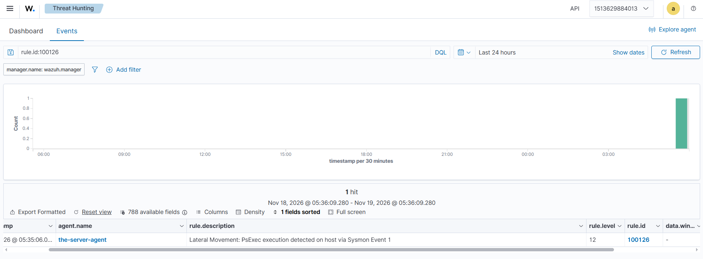

# Rule 100126 — Lateral Movement: PsExec & Remote Service Execution

*Part of [Custom Detection Rules — Master Reference](README.md). Status: **TESTED**.*

| Field | Value |
|---|---|
| Rule ID | 100126 |
| Level | 12 |
| Event | Sysmon Event 1 (Process creation) / Windows EventChannel |
| MITRE | **T1021.002** — Remote Services: SMB/Windows Admin Shares<br>**T1558.002** — Steal or Forge Kerberos Tickets: Silver Ticket |
| Group | `windows,sysmon,lateral_movement,kerberos` |
| Source | Lab 14 (`local_rules.xml`, 100126) |

## Rule

```xml
<rule id="100126" level="12">
  <!-- Inherits from Sysmon Event 1 (184665) or Windows generic (60103) -->
  <if_sid>184665,60103</if_sid>
  <field name="win.system.eventId">^1$</field>
  <!-- Matches Sysinternals PSEXESVC OR Windows root service binary execution -->
  <field name="win.eventdata.image">PSEXESVC\.exe|C:\\\\Windows\\\\([a-zA-Z0-9]+)\.exe</field>
  <description>Lateral Movement: PsExec execution detected on host via Sysmon Event 1</description>
  <mitre>
    <id>T1021.002</id>
    <id>T1558.002</id>
  </mitre>
</rule>
```

## What it detects

Process creation telemetry (**Sysmon Event ID 1**) representing remote service binary instantiation on an endpoint. Specifically, it flags:
1. Sysinternals standard PsExec service execution (`PSEXESVC.exe`).
2. Dropped service binaries directly executed from the Windows root directory (`C:\Windows\<random>.exe`), which is the standard operational signature of adversary tools such as `impacket-psexec` when establishing remote administrative access over SMB.

## Purpose

Adversaries who obtain administrative credentials or forge Kerberos tickets (such as a **Silver Ticket** targeting CIFS/SMB) leverage administrative network shares (`ADMIN$`, `C$`) to stage executable binaries and remotely invoke the Service Control Manager (SCM). 

While Windows Security Event 7045 records service installation, it lacks deep endpoint process telemetry. Rule 100126 leverages Sysmon Event 1 to capture the exact executing image, command-line arguments, process GUIDs, SHA256 hashes, and parent process lineage (`C:\Windows\System32\services.exe`), immediately escalating remote lateral movement to a **Level 12 (High Severity)** security alert.

## How it works

- **`<if_sid>184665,60103</if_sid>`** — Multi-parent inheritance:
  - **`184665`**: Built-in Wazuh rule for Sysmon Event 1 (`Sysmon - Event 1: Process creation`).
  - **`60103`**: Windows generic event fallback for EventChannel ingestion.
- **`<field name="win.system.eventId">^1$</field>`** — Strictly filters on Sysmon Process Creation events.
- **`<field name="win.eventdata.image">PSEXESVC\.exe|C:\\\\Windows\\\\([a-zA-Z0-9]+)\.exe</field>`** — Regex matching pattern:
  - Matches the static string `PSEXESVC.exe` across any directory.
  - Matches dynamically randomized 8-character or alphanumeric binary stagers dropped into `C:\Windows\` by attack frameworks (e.g., `C:\Windows\cfveLjDG.exe`, `C:\Windows\PSEXESVC.exe`).
- **Level 12** — High-severity alert representing unauthorized remote process instantiation with SYSTEM-level privileges.

## Shadowing and dependencies

- **Parent Rule:** Inherits from `184665` (Sysmon Event 1) and `60103`.
- **Shadowing:** Shadows built-in rule `184665` (Level 3 informational process creation) when matching PsExec signatures, escalating the event to an actionable SOC incident (Level 12).
- **Engineering Discovery (Sysmon EventChannel Architecture):**
  - In modern Wazuh deployments ingesting Sysmon logs via `windows_eventchannel`, Sysmon Event 1 is processed under parent rule **`184665`**.
  - Parenting Rule 100126 strictly on `60103` or legacy rule IDs resulted in detection silence because the EventChannel decoder categorized the event under the `184xxx` Sysmon rule hierarchy. Linking `<if_sid>184665,60103</if_sid>` ensures 100% reliable matching.

## Test evidence

**TESTED** — verified live in [Lab 14 — Silver Ticket (TGS Forgery) & SPN Stealth Detection Lab](../01-Core-Detection-Labs/02-Kerberos-Attacks-and-Defense-Labs/14-Silver-Ticket-TGS-Forgery-and-SPN-Stealth/) on November 19, 2026.

1. **Adversary Emulation:** Kali Linux (`192.168.100.50`) executed `impacket-psexec` targeting `soclab.local/administrator` on Windows Server 2022 (`192.168.100.146`) specifying `-remote-binary-name PSEXESVC.exe -service-name PSEXESVC`.
2. **SIEM Detection:** Wazuh fired Rule **100126** at **Level 12** on Sysmon Event 1:
   - `Image`: `C:\Windows\PSEXESVC.exe`
   - `User`: `NT AUTHORITY\SYSTEM`
   - `ParentImage`: `C:\Windows\system32\services.exe`
   - `ParentProcessId`: `648` (Service Control Manager)
   - `CommandLine`: `C:\Windows\PSEXESVC.exe`
   - `Hashes`: `SHA256=174A5525FD000E063A48C079C1AE27F6D1A06E50BD2A6767A4CA8F9A410657AD`


*Figure: Wazuh Threat Hunting dashboard confirming Rule 100126 firing at Level 12 on Sysmon Event 1 PsExec execution.*

## Find it in Wazuh

```
rule.id: 100126
```

## MITRE ATT&CK

- **T1021.002 — Remote Services: SMB/Windows Admin Shares.** Adversaries leverage SMB file sharing protocols and administrative shares (`ADMIN$`, `C$`) to upload service executables and interact with the Service Control Manager (SCM).
- **T1558.002 — Steal or Forge Kerberos Tickets: Silver Ticket.** Adversaries present forged TGS tickets directly to the CIFS service to authenticate over SMB without triggering KDC event logs on the domain controller.
