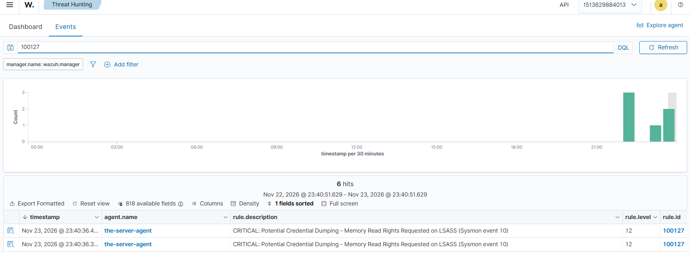

# Rule 100127 — Critical: Suspicious Memory Read Rights Requested on LSASS

*Part of [Custom Detection Rules — Master Reference](README.md). Status: **TESTED & VERIFIED** (Lab 15).*

| Field | Value |
|---|---|
| **Rule ID** | `100127` |
| **Level** | `12` (Critical High-Severity Alert) |
| **Event Source** | Sysmon Event ID `10` (`ProcessAccess`), target `lsass.exe`, `GrantedAccess` includes `VM_READ` |
| **MITRE ATT&CK** | **T1003.001** — OS Credential Dumping: LSASS Memory, **T1558** — Steal or Forge Kerberos Tickets |
| **Group** | `credential_access`, `lsass_memory_read` |
| **Parent Rule** | `100103` (`<if_sid>100103</if_sid>`) |
| **Architecture Tier** | **Tier 2: Weaponized Memory Read Threat Detector** |
| **Live Verification** | **Verified Live** in [Lab 15 — LSASS Ticket Stealing & Memory Dumping](../01-Core-Detection-Labs/02-Kerberos-Attacks-and-Defense-Labs/15-LSASS-Ticket-Stealing-and-Memory-Dumping/) |

---

## Rule Definition (XML)

```xml
<!-- TIER 2: Weaponized Memory Read Threat Detector (High Severity Alert) -->
<rule id="100127" level="12">
  <if_sid>100103</if_sid>
  <field name="win.eventdata.grantedAccess">0x1010|0x1410|0x1fffff|0x0010</field>
  <description>CRITICAL: Potential Credential Dumping - Memory Read Rights Requested on LSASS (Sysmon event 10)</description>
  <mitre>
    <id>T1003.001</id>
    <id>T1558</id>
  </mitre>
  <group>credential_access,lsass_memory_read,</group>
</rule>
```

---

## What It Detects

Any process requesting explicit **Virtual Memory Read permissions (`PROCESS_VM_READ` / `0x0010`)** against the Local Security Authority Subsystem Service (`lsass.exe`). 

Under Windows Win32 API security, memory-dumping and credential-theft tools (such as Mimikatz `sekurlsa::tickets`, Procdump, Nanodump, or Living-off-the-Land commands like `rundll32.exe comsvcs.dll, MiniDump`) cannot carve password hashes, plaintext credentials, or in-memory Kerberos ticket tables (`KERB_TICKET_CACHE`) without possessing `PROCESS_VM_READ` rights.

---

## Deciphering the `GrantedAccess` Bitmask

Windows Win32 process handles encode access rights as a hexadecimal bitmask:

| GrantedAccess | Component Rights | Operational Meaning |
|---|---|---|
| `0x1000` | `PROCESS_QUERY_LIMITED_INFORMATION` | Routine query. **No memory read.** Handled by Rule 100103 (Level 3). |
| `0x1400` | `PROCESS_QUERY_INFORMATION` \| `PROCESS_QUERY_LIMITED_INFORMATION` | Routine hypervisor / status query (`VBoxService.exe`). Handled by Rule 100103 (Level 3). |
| `0x0010` | `PROCESS_VM_READ` | Explicit right to read virtual memory pages. **Weaponized.** |
| `0x1010` | `PROCESS_QUERY_LIMITED_INFORMATION` \| `PROCESS_VM_READ` | Standard credential dumper footprint (Procdump, Nanodump). **Weaponized.** |
| `0x1410` | `PROCESS_QUERY_INFORMATION` \| `PROCESS_VM_READ` | Standard diagnostic memory dumper footprint (`comsvcs.dll`). **Weaponized.** |
| `0x1fffff` | `PROCESS_ALL_ACCESS` | Unrestricted full access handle (Mimikatz default, Task Manager). **Weaponized.** |

Rule 100127 isolates handles containing `0x0010`, `0x1010`, `0x1410`, or `0x1fffff`, triggering an immediate critical alert.

---

## How It Works (Line-by-Line)

- **`<if_sid>100103</if_sid>`** — Chains directly to parent Rule 100103 (handles opened to `lsass.exe`).
- **`<field name="win.eventdata.grantedAccess">0x1010|0x1410|0x1fffff|0x0010</field>`** — Matches only when the handle includes memory read rights.
- **`<mitre>`** — Maps directly to ATT&CK techniques `T1003.001` (LSASS Memory) and `T1558` (Kerberos Ticket Theft).
- **`level="12"`** — High-severity alert that pages on-call SOC analysts for immediate host isolation.

---

## Shadowing & Dependencies

- **Parent Rule:** Depends on **[Rule 100103](Rule-100103-LSASS-Access.md)**. If Rule 100103 is disabled or deleted, Rule 100127 will never trigger.
- **Child Rule:** Parent of **[Rule 100128](Rule-100128-Taskmgr-LSASS-Whitelist.md)** (Task Manager Whitelist).
- **Shadowing Behavior:** 
  - Shadows Rule 100103 whenever memory read rights are present.
  - Is shadowed by child Rule 100128 when the calling executable is `Taskmgr.exe`, suppressing false-positive Level 12 alerts for routine administrative operations.

---

## Test Evidence & Live Verification

- **Attack Vector Tested:** Native Windows credential dump via `rundll32.exe C:\Windows\System32\comsvcs.dll, MiniDump <PID> C:\Users\Public\lsass.dmp full`.
- **Live Firing:** Rule 100127 fired immediately at **Level 12** upon execution, capturing `SourceImage: rundll32.exe`, `TargetImage: lsass.exe`, and `GrantedAccess: 0x1fffff`:



---

## Find It in Wazuh (DQL)

```text
rule.id: 100127
```
