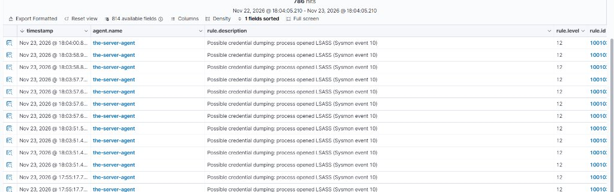

# Rule 100127 — Tuning: Suppress Benign VirtualBox LSASS Status Query

*Part of [Custom Detection Rules — Master Reference](README.md). Status: **TESTED & VERIFIED** (Lab 15).*

| Field | Value |
|---|---|
| Rule ID | 100127 |
| Level | 0 (Silent Drop / Suppression) |
| Event | Sysmon event 10 (ProcessAccess), caller `VBoxService.exe`, access mask `0x1400` |
| MITRE | — (Tuning & Alert Fatigue Elimination) |
| Group | `credential_access` |
| Parent Rule | `100103` (`<if_sid>100103</if_sid>`) |
| Live Verification | **Verified Live** in [Lab 15 — LSASS Ticket Stealing & Memory Dumping](../01-Core-Detection-Labs/02-Kerberos-Attacks-and-Defense-Labs/15-LSASS-Ticket-Stealing-and-Memory-Dumping/) |

## Rule

```xml
<rule id="100127" level="0">
  <if_sid>100103</if_sid>
  <field name="win.eventdata.sourceImage">VBoxService\.exe$</field>
  <field name="win.eventdata.grantedAccess">^0x1400$</field>
  <description>Tuning: Suppress benign VirtualBox Guest Additions status queries to LSASS</description>
</rule>
```

## What it detects & silences

This rule intercepts Sysmon Event 10 alerts generated by **`VBoxService.exe`** (the VirtualBox Guest Additions daemon) querying **`lsass.exe`** with access mask **`0x1400`** (`PROCESS_QUERY_INFORMATION`).

Because `VBoxService.exe` polls session status every 10–15 seconds to sync guest properties with the hypervisor, it previously generated a **775-alert false-positive flood** under parent Rule 100103. Rule 100127 drops these benign events at **Level 0**, leaving all other processes subject to Level 12 detection.

## Purpose

To demonstrate production-grade **Detection Tuning** in a modern SOC. Deploying detection rules without baselining leads to alert fatigue, causing analysts to overlook genuine intrusions. Rule 100127 proves how child suppression rules allow continuous monitoring of high-risk processes without drowning the SIEM.

## How it works

- **`<if_sid>100103</if_sid>`** — Chains directly to parent Rule 100103. Only evaluated when a process opens `lsass.exe`.
- **`<field name="win.eventdata.sourceImage">VBoxService\.exe$</field>`** — Matches strictly on the VirtualBox Guest Additions service path.
- **`<field name="win.eventdata.grantedAccess">^0x1400$</field>`** — Ensures suppression only applies when the access mask is `0x1400` (status query only). If an attacker hollows or injects into `VBoxService.exe` and requests `PROCESS_VM_READ` (`0x0010`), the access mask will change, causing this rule to fail and allowing parent Rule 100103 to fire!
- **`level="0"`** — Prevents Wazuh from generating an alert or indexing the document as a security incident.

## Test Evidence

- **Baseline Noise:** 775 alerts generated within minutes of enabling Sysmon Event 10.
- **Tuned Result:** 8-minute complete silence after deploying Rule 100127.
- **True-Positive Validation:** Executing `taskmgr.exe` bypassed this rule and correctly fired parent Rule 100103 at Level 12.


