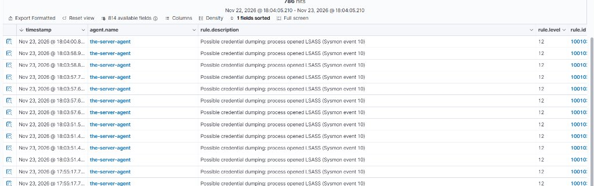

# Rule 100128 — Whitelist: Task Manager Routine Handle to LSASS

*Part of [Custom Detection Rules — Master Reference](README.md). Status: **TESTED & VERIFIED** (Lab 15).*

| Field | Value |
|---|---|
| **Rule ID** | `100128` |
| **Level** | `3` (Informational / Whitelist Suppression) |
| **Event Source** | Sysmon Event ID `10` (`ProcessAccess`), target `lsass.exe`, source `Taskmgr.exe` |
| **MITRE ATT&CK** | None (Benign Administrative Telemetry) |
| **Group** | `whitelist`, `routine_admin` |
| **Parent Rule** | `100127` (`<if_sid>100127</if_sid>`) |
| **Architecture Tier** | **Tier 3: Administrative Whitelist Suppression** |
| **Live Verification** | **Verified Live** in [Lab 15 — LSASS Ticket Stealing & Memory Dumping](../01-Core-Detection-Labs/02-Kerberos-Attacks-and-Defense-Labs/15-LSASS-Ticket-Stealing-and-Memory-Dumping/) |

---

## Rule Definition (XML)

```xml
<!-- TIER 3: Routine Task Manager Whitelist Suppression -->
<rule id="100128" level="3">
  <if_sid>100127</if_sid>
  <field name="win.eventdata.sourceImage">Taskmgr\.exe$</field>
  <description>Whitelist: Task Manager routine diagnostic handle to LSASS</description>
  <group>whitelist,routine_admin,</group>
</rule>
```

---

## What It Detects

Routine diagnostic inspections of `lsass.exe` initiated by the native Windows Task Manager (`C:\Windows\System32\Taskmgr.exe`).

---

## Purpose in the 4-Tier Hierarchy (Why Whitelist Taskmgr?)

When an administrator launches Task Manager on a server or workstation to monitor system resources, Task Manager queries performance counters, working set sizes, and thread states for every active process on the machine. To accomplish this on system processes, Task Manager requests an elevated handle with `PROCESS_ALL_ACCESS` (`0x1fffff`), which includes `PROCESS_VM_READ` (`0x0010`).

Because `0x1fffff` contains memory read rights, it directly matches the threat criteria of **[Rule 100127](Rule-100127-LSASS-Memory-Read-Detection.md)**. 

Without a specialized suppression rule, **every time a systems administrator opens Task Manager, a false-positive Level 12 critical alarm would fire on the SOC dashboard**. 

Rule 100128 solves this:
1. It inherits from parent Rule 100127 via `<if_sid>100127</if_sid>`.
2. It evaluates whether the `sourceImage` is specifically `Taskmgr.exe`.
3. If matched, it **shadows Rule 100127 and demotes the alert from Level 12 to Level 3 (Informational)**.

---

## How It Works (Line-by-Line)

- **`<if_sid>100127</if_sid>`** — Chains directly to parent Rule 100127 (weaponized handles requesting memory read).
- **`<field name="win.eventdata.sourceImage">Taskmgr\.exe$</field>`** — Matches only when the calling binary is `Taskmgr.exe`.
- **`level="3"`** — Reclassifies the diagnostic handle as benign administrative telemetry.

---

## Shadowing & Dependencies

- **Parent Rule:** Depends on **[Rule 100127](Rule-100127-LSASS-Memory-Read-Detection.md)**. If Rule 100127 is disabled, Rule 100128 cannot trigger.
- **Shadowing Behavior:** Shadows Rule 100127 specifically for `Taskmgr.exe`. Other processes requesting memory read (such as `rundll32.exe`, `mimikatz.exe`, `procdump.exe`) do not match Rule 100128 and remain alerted at Level 12 by Rule 100127.

---

## Test Evidence & Live Verification

- **Target System:** Windows Server 2022 DC (`WIN-SOCLAB`).
- **Test Executed:** Administrative execution of `taskmgr.exe`.
- **Live Verification:** Following the 8-minute silence test in Lab 15, launching Task Manager triggered Rule 100128, successfully logging the diagnostic access without paging the security team:



---

## Find It in Wazuh (DQL)

```text
rule.id: 100128
```
