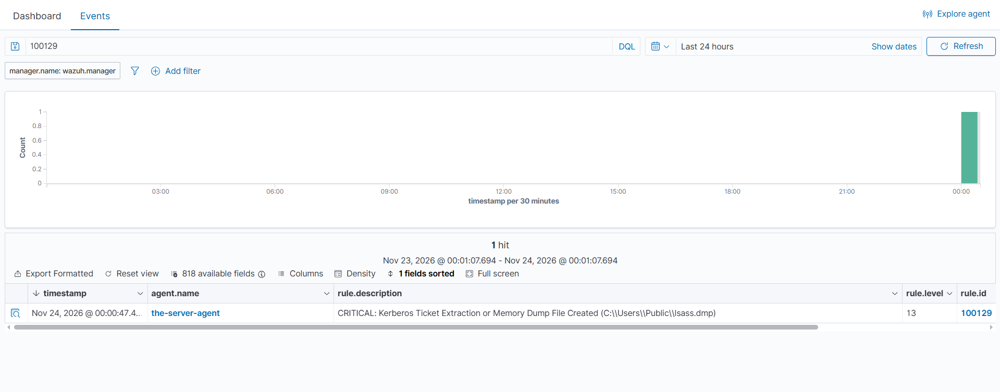

# Rule 100129 — Critical: LSASS Memory Dump or Kerberos Ticket File Written to Disk

*Part of [Custom Detection Rules — Master Reference](README.md). Status: **TESTED & VERIFIED** (Lab 15).*

| Field | Value |
|---|---|
| **Rule ID** | `100129` |
| **Level** | `13` (Maximum Critical High-Severity Alert) |
| **Event Source** | Sysmon Event ID `11` (`FileCreate`), target filename matching `lsass.*\.dmp` or `\.kirbi` |
| **MITRE ATT&CK** | **T1003.001** — OS Credential Dumping: LSASS Memory, **T1558** — Steal or Forge Kerberos Tickets |
| **Group** | `credential_access`, `lsass_dump_file` |
| **Parent Rule** | None (inherits from core group `windows`) |
| **Architecture Tier** | **Tier 4: File System Artifact / Payload Drop Detector** |
| **Live Verification** | **Verified Live** in [Lab 15 — LSASS Ticket Stealing & Memory Dumping](../01-Core-Detection-Labs/02-Kerberos-Attacks-and-Defense-Labs/15-LSASS-Ticket-Stealing-and-Memory-Dumping/) |

---

## Rule Definition (XML)

```xml
<!-- TIER 4: Dump / Kerberos Ticket File Created on Disk (Sysmon Event ID 11) -->
<rule id="100129" level="13">
  <if_group>windows</if_group>
  <field name="win.system.eventID">^11$</field>
  <field name="win.eventdata.targetFilename" type="pcre2">(?i)lsass.*\.dmp|\.kirbi</field>
  <description>CRITICAL: LSASS Memory Dump or Kerberos Ticket File Written to Disk</description>
  <mitre>
    <id>T1003.001</id>
    <id>T1558</id>
  </mitre>
  <group>credential_access,lsass_dump_file,</group>
</rule>
```

---

## What It Detects

Any process creating a file on disk whose filename matches the case-insensitive pattern `lsass.*\.dmp` (such as `C:\Users\Public\lsass.dmp`) or contains the Kerberos ticket file extension `\.kirbi` (the proprietary binary format exported by Mimikatz `sekurlsa::tickets /export`). Recorded via Sysmon Event ID `11` (`FileCreate`) from `Microsoft-Windows-Sysmon/Operational`.

---

## Purpose in the 4-Tier Hierarchy (Why Level 13 & Event ID 11?)

While Tiers 1–3 (Rules 100103, 100127, and 100128) monitor the **process handle layer** via Sysmon Event ID 10, sophisticated adversaries frequently attempt to evade handle monitoring using:
- **Direct System Calls (Syscalls):** Bypassing user-mode Win32 API hooks (`ntdll.dll`).
- **Process Injection / Hollowed Processes:** Operating from inside trusted processes.
- **Kernel-Level Drivers:** Dumping memory without invoking standard user-mode APIs.

Rule 100129 provides an **orthogonal, defense-in-depth safety net at the file system persistence layer**:
1. Even if an attacker evades Event ID 10 detection during the memory read phase, they must typically persist the dumped memory or carved ticket files to disk before exfiltrating them.
2. The instant `comsvcs.dll`, `procdump`, `nanodump`, or `mimikatz` writes `lsass.dmp` or `.kirbi` tickets to any directory (e.g., `C:\Users\Public\`, `C:\Windows\Temp\`, or Desktop), **Rule 100129 triggers a Level 13 alarm (the highest operational priority in Wazuh)**.

---

## How It Works (Line-by-Line)

- **`<if_group>windows</if_group>`** — Ensures the rule only evaluates events processed by the Windows decoder.
- **`<field name="win.system.eventID">^11$</field>`** — Matches Sysmon Event ID `11` (`FileCreate`).
- **`<field name="win.eventdata.targetFilename" type="pcre2">(?i)lsass.*\.dmp|\.kirbi</field>`** — Utilizes Perl-Compatible Regular Expressions (PCRE2) with case-insensitivity `(?i)`:
  - Matches any file starting with `lsass` and ending with `.dmp` (e.g. `lsass.dmp`, `lsass_2026.dmp`).
  - Matches any file containing `.kirbi` (exported Kerberos TGT/TGS tickets).
- **`level="13"`** — Maximum priority alert triggering automated containment and tier-1 incident response workflows.

---

## Shadowing & Dependencies

- **Parent Rules:** None (inherits from core group `windows`).
- **Child Rules:** None.
- **Shadowing Behavior:** Standard Sysmon Event 11 rules in Wazuh default to Level 3 informational logging. Rule 100129 matches on the specific suspicious filenames, effectively escalating these critical credential dump artifacts to Level 13.

---

## Test Evidence & Live Verification

- **Attack Vector Tested:** Native Windows credential dump via `rundll32.exe C:\Windows\System32\comsvcs.dll, MiniDump <PID> C:\Users\Public\lsass.dmp full`.
- **Live Firing:** Upon completion of the dump, Sysmon Event ID 11 was generated for `TargetFilename: C:\Users\Public\lsass.dmp`. **Rule 100129 fired immediately at Level 13**:



---

## Find It in Wazuh (DQL)

```text
rule.id: 100129
```
