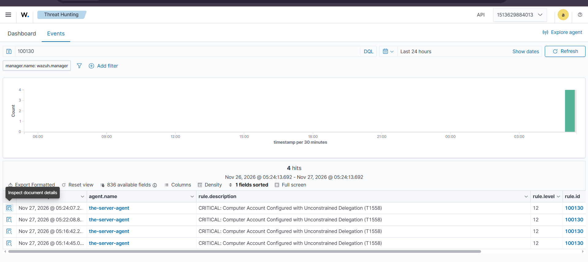

# Rule 100130 — Critical: Computer Account Configured with Unconstrained Delegation (Event 4742)

*Part of [Custom Detection Rules — Master Reference](README.md). Status: **TESTED & VERIFIED** (Lab 16).*

| Field | Value |
|---|---|
| **Rule ID** | `100130` |
| **Level** | `12` (Critical High-Severity Alert) |
| **Event Source** | Windows Security Event ID `4742` (`Computer account changed`) |
| **MITRE ATT&CK** | **T1558** — Steal or Forge Kerberos Tickets |
| **Group** | `kerberos_delegation`, `privilege_escalation` |
| **Parent Rule** | `60121` (`<if_sid>60121</if_sid>`) |
| **Live Verification** | **Verified Live** in [Lab 16 — Unconstrained Delegation & PrinterBug](../01-Core-Detection-Labs/02-Kerberos-Attacks-and-Defense-Labs/16-Unconstrained-Delegation-and-PrinterBug/) |

---

## Rule Definition (XML)

```xml
<!-- Rule 100130: Computer Account Modified with Unconstrained Delegation (Event 4742) -->
<rule id="100130" level="12">
  <if_sid>60121</if_sid>
  <field name="win.system.eventID">^4742$</field>
  <field name="win.eventdata.userAccountControl" type="pcre2">2093</field>
  <description>CRITICAL: Computer Account Configured with Unconstrained Delegation (T1558)</description>
  <mitre>
    <id>T1558</id>
  </mitre>
  <group>kerberos_delegation,privilege_escalation,</group>
</rule>
```

---

## What It Detects

Any Active Directory computer account modified to enable **Unconstrained Delegation** (`TrustedForDelegation = $true`, UAC flag `0x80000`). In Windows Server 2022 Event ID `4742`, enabling `Trusted For Delegation` logs `win.eventdata.userAccountControl` as `%%2093` (whereas disabling it logs `%%2061`).

---

## How It Works & Shadowing

- **`<if_sid>60121</if_sid>`** — Chains directly to Wazuh's built-in Rule `60121` (*Computer account added/changed/deleted*, Level 5), ensuring `60121` is cleanly shadowed when `%%2093` is present.
- **`<field name="win.eventdata.userAccountControl" type="pcre2">2093</field>`** — Matches `%%2093` (*'Trusted For Delegation' - Enabled*) and ignores `%%2061` (*Disabled*).

---

## Test Evidence (Verified Live in Lab 16)

Executed `Set-ADComputer -Identity "FAKE-SRV" -TrustedForDelegation $true` on `WIN-SOCLAB`. Rule `100130` fired immediately at Level 12:



---

## Find It in Wazuh (DQL)

```text
rule.id: 100130
```
