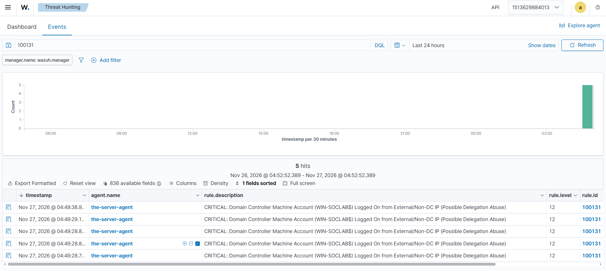

# Rule 100131 — Critical: Domain Controller Machine Account Logged On from External/Non-DC IP

*Part of [Custom Detection Rules — Master Reference](README.md). Status: **TESTED & VERIFIED** (Lab 16).*

| Field | Value |
|---|---|
| **Rule ID** | `100131` |
| **Level** | `12` (Critical High-Severity Alert) |
| **Event Source** | Windows Security Event ID `4624` (Network Logon) |
| **MITRE ATT&CK** | **T1558** — Steal or Forge Kerberos Tickets |
| **Group** | `kerberos_delegation`, `lateral_movement` |
| **Parent Rule** | Core `windows` group |
| **Live Verification** | **Verified Live** in [Lab 16 — Unconstrained Delegation & PrinterBug](../01-Core-Detection-Labs/02-Kerberos-Attacks-and-Defense-Labs/16-Unconstrained-Delegation-and-PrinterBug/) |

---

## Rule Definition (XML)

```xml
<!-- Rule 100131: DC Machine Account Authenticating from Non-DC IP -->
<rule id="100131" level="12">
  <if_group>windows</if_group>
  <field name="win.system.eventID">^4624$</field>
  <field name="win.eventdata.targetUserName">^WIN-SOCLAB\$$</field>
  <field name="win.eventdata.ipAddress" type="pcre2" negate="yes">^(192\.168\.100\.146|127\.0\.0\.1|::1|-)$</field>
  <description>CRITICAL: Domain Controller Machine Account (WIN-SOCLAB$) Logged On from External/Non-DC IP (Possible Delegation Abuse)</description>
  <mitre>
    <id>T1558</id>
  </mitre>
  <group>kerberos_delegation,lateral_movement,</group>
</rule>
```

---

## What It Detects

The Domain Controller's own machine account (`WIN-SOCLAB$`) authenticating over the network from any IP address other than the DC itself (`192.168.100.146`, `127.0.0.1`, `::1`). This is the definitive signature of a stolen DC TGT captured via **Unconstrained Delegation + PrinterBug** being replayed from an attacker host (`192.168.100.50`) to perform DCSync.

---

## Test Evidence (Verified Live in Lab 16)

Triggered `impacket-secretsdump -k -no-pass` from Kali (`192.168.100.50`) using the coerced `WIN-SOCLAB$` TGT. Rule `100131` fired immediately at Level 12:



---

## Find It in Wazuh (DQL)

```text
rule.id: 100131
```
