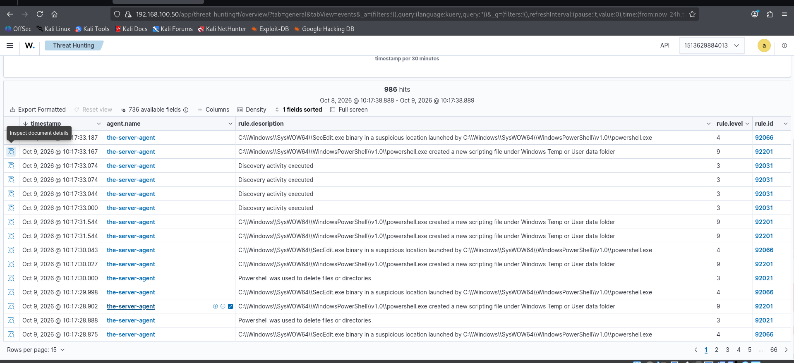
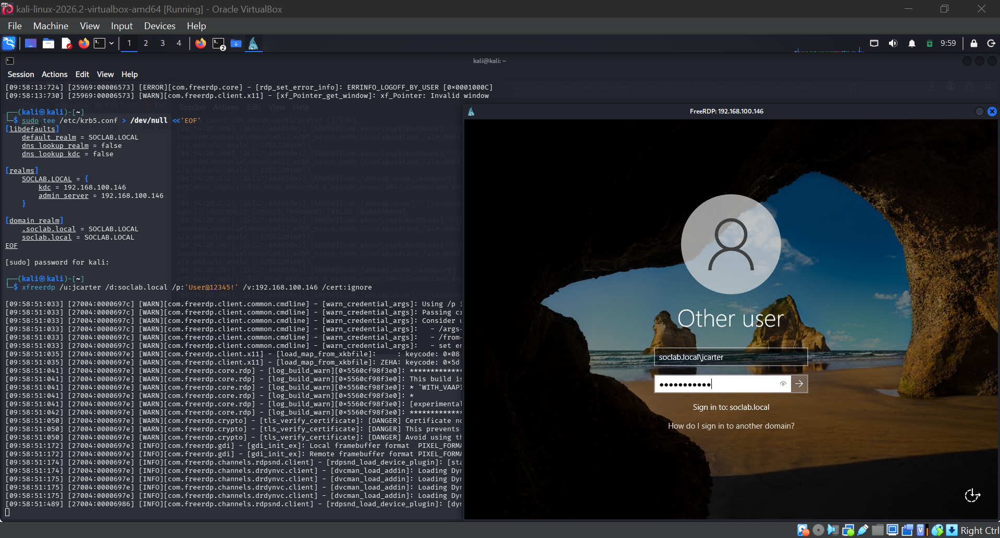

# 🏠 Wazuh Home SOC Lab

A complete, working home Security Operations Center: **Wazuh 4.14.5 SIEM** (Docker, on Kali Linux) monitoring a **Windows Server 2022 domain controller** (`soclab.local`) — an A→Z build guide, seven hands-on detection labs, and a 27-event account-management deep dive. Every attack simulated, every event captured, every alert triaged.

Built October 2026 as the SIEM phase of my SOC Analyst journey. This lab is designed to keep growing — new folders land here as new detections, rules, and scenarios are built.

## Architecture

```
┌─────────────────────────┐         1514/tcp (agent events)
│  Kali Linux 2026.2      │         1515/tcp (enrollment)
│  192.168.100.50         │ ◄──────────────────────────┐
│  (attacker box + SIEM)  │                            │
│  ┌───────────────────┐  │                    ┌───────┴──────────────┐
│  │ wazuh.indexer-1   │  │                    │ Windows Server 2022  │
│  │ wazuh.manager-1   │  │                    │ WIN-SOCLAB           │
│  │ wazuh.dashboard-1 │  │                    │ 192.168.100.146      │
└─────────────────────────┘                    │ soclab.local (DC)    │
         ▲                                     │ agent 001: Active ✅  │
         │ https://192.168.100.50              └──────────────────────┘
      Analyst
     (browser)
```

## Lab Index

| # | Folder | What it proves | Key event IDs |
|---|---|---|---|
| 00 | [Wazuh SIEM — Installation & Configuration](00-Wazuh-SIEM-Installation-and-Configuration/) | A→Z build: Docker → Wazuh stack → agent → Kerberos → static IPs, every command explained | — |
| 01 | [Core Detection Labs](01-Core-Detection-Labs/) | Eight foundational labs — RDP logons, privilege escalation, account lifecycle, brute-force triage, chained attack, rogue-admin purple team, alert triage SOP, and Kerberos AS-REP roasting incident triage | 4624, 4625, 4728, 4729, 4720–4740, 4767, 4688, 1102, 4768, 4769, 4771 |
| 02 | [Account Management: 27 Events Mapped to Wazuh](02-Account-Management-27-Events/) | Every account-management event that matters, generated by hand and mapped rule-by-rule to Wazuh — the interview-prep deep dive | 27 events, 4720–4781 |
| 04 | [Audit Policy Setup](04-Audit-Policy-Setup/) | Why most events are invisible on a fresh server — the full `auditpol` enable list, before/after state, and the Group Policy warning | 4688, 4720, 4728, 4624, 4719 |
| 05 | [Chained Attack: One Incident, Five Alerts](01-Core-Detection-Labs/05-Chained-Attack-One-Incident-Five-Alerts/) | One attacker story, five alerts — backdoor account → privileged group → RDP → process → log cleared, verified end to end | 4720, 4728, 4624, 4688, 1102 |
| 06 | [Rogue Admin: The Chain as a Purple-Team Story](01-Core-Detection-Labs/06-Rogue-Admin-Purple-Team/) | Lab 05 retold as one attack story, then broken step by step — evasion, what still catches it, and re-tests | 4720, 4728, 4624, 4688, 1102 |
| 07 | [Alert Triage SOP](01-Core-Detection-Labs/07-Alert-Triage-SOP/) | What the analyst does when an alert arrives — one triage flow, per-alert playbooks, severity ranking, escalation criteria, and what to record | 4720, 4728, 4624, 4688, 1102, 4738 |
| 08 | [Logon & Authentication: 14 Events Mapped to Wazuh](05-Logon-and-Authentication-14-Events/) | Logon and Kerberos authentication mapped to Wazuh — 4624 and 4625 tuned with custom rules, 4768/4769/4771 Kerberos triad mapped | 4624, 4625, 4768, 4769, 4771 (+ 9 to verify) |
| 09 | [Custom Detection Rules — Master Reference](06-Custom-Detection-Rules-Reference/) | One file per rule for all 18 custom rules (100100–100117): exact XML, purpose, line-by-line explanation, shadowing map, test evidence or test plan, DQL query, MITRE mapping | 4624, 4625, 4720, 4728, 4738, 4768, 4769, 7045, 1102 |

## How to use this repo

1. Start with **00** — it builds the exact environment the labs ran in.
2. Work through **01** (seven labs, in folder order); each assumes the previous one's setup.
3. Then **02** — the 27-event account-management deep dive, built for interview revision.
4. Every lab README follows the same shape: **Overview → What Is This Lab → Lab Steps (every command explained) → What Wazuh Said → SOC Takeaways**, with screenshots embedded where they were captured.

## 🎁 Bonus Lesson — Tuning: When the SIEM Alarms on Itself

During the static-IP work, the dashboard lit up with PowerShell behavior alerts:



---

- **92066**: `secedit.exe` launched by PowerShell — level 4
- **92201**: PowerShell wrote a script file under Temp — level 9
- **92031 / 92021**: discovery activity, file deletion — level 3

Expanding the 92066 alert and reading `parentCommandLine` identified the culprit:



---

```
powershell "$null = secedit /export /cfg $env:temp/secexport.cfg; ...
  Select-String "LSAAnonymousNameLookup" ..."
```

That's **Wazuh's own SCA (compliance) scanner** checking a CIS benchmark setting, running as `NT AUTHORITY\SYSTEM`. The SIEM's scanner tripped the SIEM's detection rule.

**The lesson:** rules detect *behavior*, not *intent*. Severity ≠ certainty — a level 9 can be your own tooling. The fix is never "disable the rule"; it's carving out the known-good pattern (exclude `secexport.cfg` / SYSTEM-parented SCA activity) so a *real* attacker abusing `secedit` still fires. Every SOC keeps a list like this.

## Coming next

- [x] Sysmon install + `Microsoft-Windows-Sysmon/Operational` channel in `ossec.conf` — verified Nov 5, 2026, Sysmon 11 FileCreate flowing (see Lab 05)
- [x] Custom detection rule: **1102** (audit log cleared) — done, rule **100108**, level 12 (Lab 05, Step 5)
- [x] Custom detection rule: louder **4728** for privileged-group additions — done, rule **100105**, level 10 (Lab 01)
- [ ] `wazuh-archives` index for full event retention
- [ ] More attack scenarios (persistence, lateral movement, living-off-the-land)

---

*Part of [SOC-Journey-2026](../README.md) — 90+ lab-generated Windows event IDs, protocol labs, malware triage, and now a live SIEM with real detections.*
